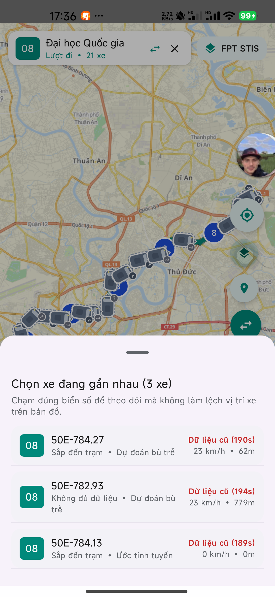
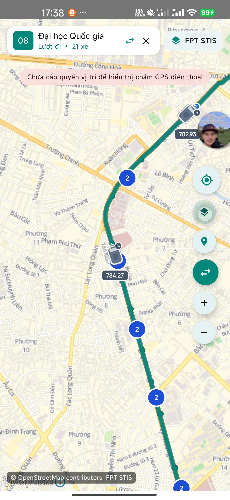
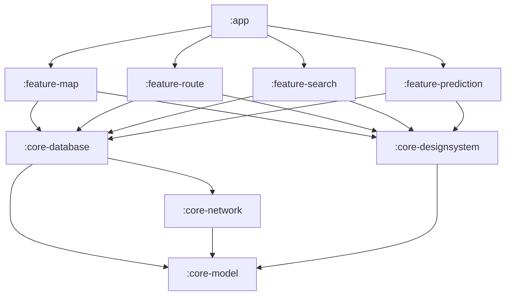

# HCMC Bus Tracker (MultiGo Reworked)

Ứng dụng Android tra cứu lộ trình, theo dõi vị trí xe buýt và dự báo thời gian đến trạm tại Thành phố Hồ Chí Minh với độ tin cậy cao.

Ứng dụng sử dụng **nguồn dữ liệu chính thức** từ hệ thống EBMS của Trung tâm Quản lý Giao thông công cộng TP.HCM (`https://apicms.ebms.vn`) kết hợp nền tảng bản đồ số nguồn mở **MapLibre Native SDK** (`11.5.2`) và **OpenStreetMap / FPT STIS**.

> Phiên bản **v1.0.0** đã kiểm thử **36 test suites / 191 unit tests PASS**, nghiệm thu thực tế trên thiết bị Android (`Xiaomi M2102J2SC`, Android 13, 440 dpi) và phát hành APK đã ký tại [GitHub Releases](https://github.com/thuanmazda/hcmc-bus-tracker/releases/tag/v1.0.0).

---

## 1. TÍNH NĂNG CHÍNH

### Bản đồ Trực quan & Marker Top-Down Bus Coach (Phase 12)
- **Biểu tượng xe buýt nhìn từ trên xuống (`Top-Down Coach`):** Chuẩn kích thước `dp` nhất quán mọi mật độ (`mdpi` `160` – `xxxhdpi` `640`), gồm thân xe (`38 dp` thường / `50 dp` khi chọn + halo hổ phách `58.8 dp`), kính trước, đèn đầu, điều hòa nóc, bóng đổ và mũi định hướng tách biệt hoàn toàn với mũi tên một chiều trên raster tile.
- **Xoay hướng mượt & giữ trạng thái trung thực:** Nội suy cung tròn ngắn nhất qua biên `0° / 360°` (`BearingSmoother`), ẩn mũi hướng khi `hasValidHeading = false`, phân biệt trạng thái `ACTIVE`, `DELAYED`, `STALE_OR_HELD` và huy hiệu góc (`ARRIVING`, `AT_STOP`, `PASSED`, `STALE_CLOCK`).
- **Nhãn biển số thích ứng 3 mức zoom:** Ẩn ở zoom thấp (`< 13.0`), rút gọn ở zoom trung bình (`13.0..14.8`, VD: `784.27`), đầy đủ ở zoom cao (`>= 14.8` hoặc xe đang chọn, VD: `50E-784.27`), chống va chạm nhãn và căn khoảng hở sạch bên dưới xe.
- **Tụ điểm trạm & chọn xe chồng lấn:** Gom nhóm trạm (`clusterMaxZoom = 13`), bộ giải quyết chạm `44 dp` + Bottom Sheet **Chọn xe đang gần nhau** (`VehicleOverlapPickerSheet`) không làm lệch tọa độ GPS thật, thứ tự lớp Z 11 tầng (`MapLayerManager`) giữ Google Maps Blue Dot luôn nổi trên cùng.

### Bù trễ GPS & Thu thập Dữ liệu Đa luồng (Phase 11)
- **GPS Latency Compensation & Interpolation:** `PositionCompensationEngine` và `VehicleInterpolationEngine` phân loại độ tươi `dts`, bù trễ có giới hạn trên polyline và giữ vị trí hợp lệ cuối khi dữ liệu cũ/đứng yên.
- **Adaptive Concurrent Polling:** `GlobalPollingCoordinator`, `AdaptiveConcurrencyController`, `SharedStopCoalescer` và `VehicleDataMerger` gộp checkpoint dùng chung và điều chỉnh luồng polling kiểm soát 429/5xx.
- **Camera State Machine ổn định:** Chuyển mượt giữa `FOCUS_VEHICLE`, `FOLLOW_VEHICLE`, `USER_CONTROLLED` (tạm dừng khi kéo bản đồ) và `IDLE`.

### Tra cứu Lộ trình, Dự báo ETA, Tìm kiếm & Cá nhân hóa
- **Danh mục & Chi tiết tuyến (`:feature-route`):** Hơn 130 tuyến nội thành/liên tỉnh TP.HCM, chiều đi/về (`RouteVariant`), giờ hoạt động, cự ly, giá vé và danh sách trạm tuần tự.
- **Tìm kiếm tiếng Việt thông minh (`:feature-search`):** Hơn 6.000 điểm dừng, chuẩn hóa có dấu/không dấu (`VietnameseNormalizer`), debounce 300ms.
- **Dự báo ETA thời gian thực (`:feature-prediction`):** Khoảng cách, ETA, biển số, tốc độ, tuổi GPS (`predictbystopid` / `predictnextstops`), cảnh báo minh bạch dữ liệu cũ.
- **Cá nhân hóa & Thông báo:** Lưu tuyến/trạm yêu thích (Room Database v2), cài đặt chu kỳ polling (`10s / 15s / 30s / 60s`), thông báo xe đến trạm (`POST_NOTIFICATIONS` Android 13+, cooldown 5 phút, lọc GPS cũ > 180s), giao diện Sáng / Tối / Theo hệ thống.

---

## 2. ẢNH CHỤP NGHIỆM THU THỰC TẾ (XIAOMI M2102J2SC)

| Zoom thấp (21 xe & Cluster) | Chọn xe chồng lấn (Bottom Sheet) | Xe được chọn & Nhãn đầy đủ | Zoom trung bình & Nhãn rút gọn |
| :---: | :---: | :---: | :---: |
|  |  |  |  |

Xem thêm bộ ảnh và báo cáo chi tiết tại [docs/PHASE_12_ROUND_4D_SCREENSHOT_INDEX.md](docs/PHASE_12_ROUND_4D_SCREENSHOT_INDEX.md).

---

## 3. KIẾN TRÚC MODULE



- **`:core-model`:** Domain models, `PositionCompensationEngine`, `VehicleDataMerger`, `VietnameseNormalizer`.
- **`:core-network`:** Retrofit 2, OkHttp 3, Kotlinx Serialization, `GlobalPollingCoordinator`, `AdaptiveConcurrencyController`, `SharedStopCoalescer`.
- **`:core-database`:** Room Database v2, SQLite DAOs, `BusRepository`, `StaticDatasetManager`.
- **`:core-designsystem`:** Jetpack Compose Material 3 components, Brand colors, Typography, Theming.
- **`:feature-map`:** `MapScreen`, `MapViewModel`, `VehicleInterpolationEngine`, `VehicleMarkerBitmapFactory`, `MapLayerManager`, `VehicleRenderDiffer`, `VehicleOverlapPicker`.
- **`:feature-route`:** Danh sách tuyến, chi tiết lộ trình và biến thể lượt đi/lượt về.
- **`:feature-search`:** Tìm kiếm tuyến/trạm với debounce và chuẩn hóa tiếng Việt.
- **`:feature-prediction`:** Dự báo ETA thời gian thực, cá nhân hóa, quản lý thông báo.
- **`:app`:** Application (`HcmcBusTrackerApp`), Hilt DI, `MainActivity` NavHost & NavigationShell.

---

## 4. YÊU CẦU MÔI TRƯỜNG & HƯỚNG DẪN BUILD

- **JDK:** Java 21 (khuyến nghị Android Studio JBR 21).
- **Android SDK:** `compileSdk = 35`, `minSdk = 26` (Android 8.0+), `targetSdk = 35`.

### 4.1. Chạy toàn bộ Unit Tests
```powershell
$env:JAVA_HOME = "C:\Program Files\Android\Android Studio\jbr"
.\gradlew.bat testDebugUnitTest --rerun
```

### 4.2. Đóng gói Debug & Release APK đã ký
1. Sao chép `keystore.properties.example` thành `keystore.properties` và điền thông tin keystore (tệp `keystore.properties` và thư mục `release-keystore/` đã được `.gitignore` loại trừ hoàn toàn, không đưa lên Git):
   ```powershell
   Copy-Item "keystore.properties.example" "keystore.properties"
   ```
2. Build APK:
   ```powershell
   .\gradlew.bat assembleDebug
   .\gradlew.bat assembleRelease
   ```
   - Debug APK: `app/build/outputs/apk/debug/app-debug.apk`
   - Release APK (signed v2): `app/build/outputs/apk/release/app-release.apk`
   - Hướng dẫn chi tiết xem tại [docs/RELEASE_BUILD_GUIDE.md](docs/RELEASE_BUILD_GUIDE.md).

### 4.3. Cài đặt nhanh từ bản phát hành
Tải **`HCMC-Bus-Tracker-v1.0.0-release.apk`** từ trang [Releases v1.0.0](https://github.com/thuanmazda/hcmc-bus-tracker/releases/tag/v1.0.0) hoặc cài qua ADB:
```powershell
adb install -r HCMC-Bus-Tracker-v1.0.0-release.apk
```

---

## 5. BẢN QUYỀN & NGUỒN DỮ LIỆU

- **Dữ liệu giao thông công cộng:** Trung tâm Quản lý Giao thông công cộng TP.HCM (`buyttphcm.com.vn` / EBMS API).
- **Dữ liệu bản đồ số:** © [OpenStreetMap contributors](https://www.openstreetmap.org/copyright), FPT STIS.
- **Thư viện bản đồ:** MapLibre Native SDK for Android (`11.5.2`).
