# HCMC Bus Tracker

Ứng dụng Android tra cứu lộ trình, theo dõi vị trí xe buýt và dự báo thời gian đến trạm tại Thành phố Hồ Chí Minh với độ tin cậy cao.

*An open-source, privacy-conscious Android application for tracking public transit buses, routes, and arrival predictions in Ho Chi Minh City.*

---

## 1. TỔNG QUAN / OVERVIEW

Ứng dụng sử dụng nguồn dữ liệu mở/công khai từ hệ thống EBMS của Trung tâm Quản lý Giao thông công cộng TP.HCM (`https://apicms.ebms.vn`) kết hợp nền tảng bản đồ số nguồn mở **MapLibre Native SDK** (`11.5.2`) và nguồn bản đồ nền **OpenStreetMap / FPT STIS**.

- **Phiên bản hiện tại:** `v1.1.0` (Build 2) — Xem chi tiết thay đổi tại [CHANGELOG.md](file:///e:/MultiGo%20Reworked/CHANGELOG.md)
- **Kiểm thử tự động:** **42 test suites / 259 unit tests PASS (100%)**, Android Lint passed.
- **Nghiệm thu thiết bị thật:** Đã nghiệm thu toàn diện trên thiết bị Android (`Xiaomi Mi 10S - M2102J2SC`, HyperOS 1.0 / Android 13, 440 dpi, AMOLED 90Hz).
- **Tải bản phát hành:** Tải APK chính thức đã ký số tại [GitHub Releases](https://github.com/thuanmazda/hcmc-bus-tracker/releases).

---

## 2. NHỮNG ĐIỂM CẢI THIỆN NỔI BẬT TRÊN BẢN 1.1.0 SO VỚI 1.0.0 (WHAT'S NEW IN V1.1.0)

Phiên bản **1.1.0** là bước nâng cấp toàn diện tập trung vào trải nghiệm thực tế, hoàn thiện thẩm mỹ giao diện, tối ưu hóa vòng đời tài nguyên và gia cố an ninh thông tin:

### 🎨 Khắc phục Triệt để Khuyết tật Giao diện & Thẩm mỹ (UI Polishing)
- **UI-001 (ArrivalCard Speed Wrap):** Khắc phục hoàn toàn lỗi ngắt dòng từng ký tự của giá trị tốc độ. Tốc độ xe cùng đơn vị đo lường luôn hiển thị nguyên khối trên 1 dòng duy nhất (`24 km/h`, `20 km/h`, `0 km/h`).
- **UI-002 (Route Title Ellipsis):** Bổ sung dấu ba chấm (`...`) tự động khi tên tuyến buýt hoặc tên điểm dừng quá dài tại `RouteCard`, `RouteDetailScreen`, `ArrivalCard` và `SearchScreen`, chấm dứt hiện tượng chữ bị cắt cụt đột ngột.
- **UI-003 (Stop Address Formatting):** Chuẩn hóa chuỗi địa chỉ trạm dừng xe buýt, làm sạch dữ liệu và loại bỏ triệt để các dấu phẩy phân cách thừa hoặc nội dung hiển thị dở dang.
- **UI-004 (VehicleTrackingSheet Navigation Bar Inset):** Khắc phục lỗi thanh điều hướng hệ thống (Android System Navigation Bar) che lấp nội dung và nút bấm Bottom Sheet bằng cách áp dụng padding an toàn `navigationBarsPadding()`.
- **UI-005 (Search Filter Chips Scrolling):** Nâng cấp thanh bộ lọc màn hình Tìm kiếm sang dạng `LazyRow` cuộn ngang êm ái, hỗ trợ hiển thị đầy đủ các nhóm lọc: *Tất cả*, *Tuyến xe*, *Trạm dừng*, *Biển số xe*.
- **UI-006 (VehicleSearchResultCard Button Collision):** Tối ưu hóa layout thẻ kết quả tìm kiếm phương tiện, tách biệt rõ ràng giữa tên điểm dừng đón xe (`Chùa Ông`) và nút điều hướng (`Xem trên bản đồ ->`), không còn hiện tượng dính chữ.
- **OBS-01 (StopPrediction TopAppBar Ellipsis):** Giới hạn `maxLines = 1` và áp dụng `TextOverflow.Ellipsis` cho subtitle địa chỉ trạm dừng tại thanh tiêu đề TopAppBar màn hình Dự báo, không che lấp nút Yêu thích và nút Làm mới.

### ⚡ Gia cố Vòng đời Polling & Tối ưu hóa Hiệu năng (Lifecycle & Memory Hardening)
- **Kiểm soát Polling thông minh:** Tích hợp `DisposableEffect(lifecycleOwner)` trong `MapScreen`, kiểm soát nghiêm ngặt hai sự kiện vòng đời `onMapResumed` và `onMapPaused`. Luồng kết nối mạng và GPS polling tự động dừng hoàn toàn ngay khi người dùng chuyển sang tab khác hoặc đưa ứng dụng xuống nền, loại trừ lãng phí pin, dữ liệu di động và rò rỉ bộ nhớ.
- **Tối ưu hiển thị 90Hz:** Đảm bảo MapLibre Native SDK render các lớp vector map và marker xe buýt mượt mà ở tần số quét 90Hz trên màn hình AMOLED.

### 🛰️ Thống nhất Ngưỡng GPS Freshness Toàn Ứng dụng
- Đồng bộ hóa 4 cấp độ trạng thái độ tươi GPS:
  - **`FRESH`:** $\le 60$ giây.
  - **`SLIGHT_DELAY`:** $> 60$ giây đến $\le 120$ giây.
  - **`DELAYED`:** $> 120$ giây đến $\le 300$ giây.
  - **`STALE`:** $> 300$ giây.
- Tự động hiển thị huy hiệu cảnh báo minh bạch **"Tín hiệu GPS cũ"** trên các thẻ phương tiện khi độ trễ dữ liệu vượt ngưỡng cho phép.

### 🔍 Tra cứu Phương tiện Trực tiếp (`ActiveFleetRegistry`)
- Bổ sung công cụ tra cứu biển số xe theo thời gian thực kết hợp thuật toán chuẩn hóa biển số (`LicensePlateNormalizer`), cho phép tìm kiếm chính xác cả định dạng đầy đủ (vd: `50E-620.14`) hoặc 5 số cuối (`62014`).
- Lưu trữ lịch sử tìm kiếm cục bộ tối đa 15 mục gần nhất, hỗ trợ xóa từng mục hoặc xóa toàn bộ lịch sử.

### 🛡️ Nâng cấp An toàn & Bảo mật Hệ thống (Security Hardening)
- **SEC-01:** Khóa hoàn toàn tính năng tự động sao lưu ứng dụng (`android:allowBackup="false"`), ngăn ngừa trích xuất dữ liệu nội bộ trái phép qua giao thức ADB hoặc auto-backup không mã hóa.
- **SEC-02:** Cưỡng chế 100% kết nối mạng qua giao thức HTTPS có mã hóa TLS (`android:usesCleartextTraffic="false"`).
- **Release Signing Enforcement:** Cơ chế xác thực thông tin chữ ký kép trong `app/build.gradle.kts`, ngăn chặn tạo bản phát hành unsigned APK.
- **Bảo mật tuyệt đối Secrets:** Toàn bộ Keystore, mật khẩu và `keystore.properties` được giữ cục bộ, loại trừ nghiêm ngặt khỏi Git.

### 🧪 Mở rộng Độ bao phủ Kiểm thử Tự động
- Tăng từ 36 test suites / 191 unit tests (v1.0.0) lên **42 test suites / 259 unit tests PASS (100%)** trên 9 modules.

---

## 3. HÌNH ẢNH NGHIỆM THU THỰC TẾ TRÊN THIẾT BỊ / SCREENSHOTS

Toàn bộ ảnh chụp thực tế dưới đây được trích xuất trực tiếp từ thiết bị **Xiaomi Mi 10S** (Android 13 / HyperOS 1.0, màn hình AMOLED 90Hz, 440 dpi):

### Giao diện Phiên bản 1.1.0 Mới Nhất

| Trang chủ & Bản đồ xem trước | Bản đồ MapLibre 90Hz & Trạm dừng | Chi tiết Trạm dừng & Tuyến đi qua |
| :---: | :---: | :---: |
| 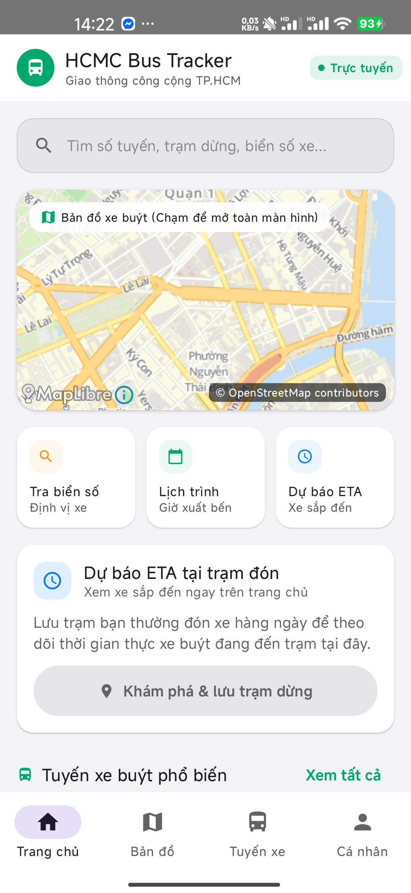 | 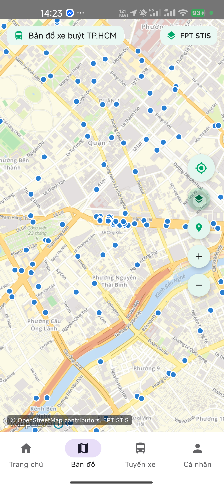 | 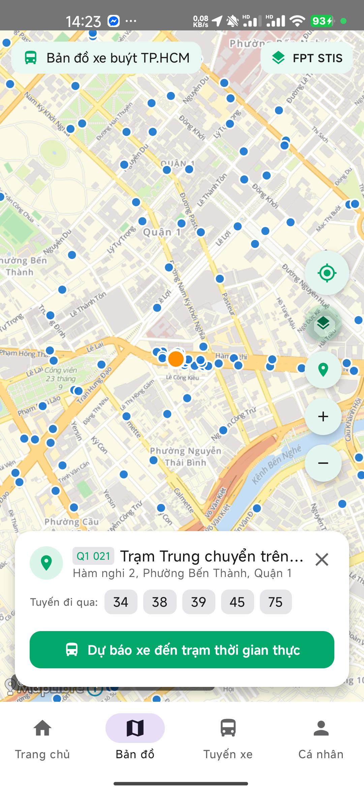 |

| Dự báo ETA Trực tiếp (Live Telemetry) | Danh mục 181 Tuyến xe buýt TP.HCM | Chi tiết Lộ trình Tuyến & 30 Trạm dừng |
| :---: | :---: | :---: |
| 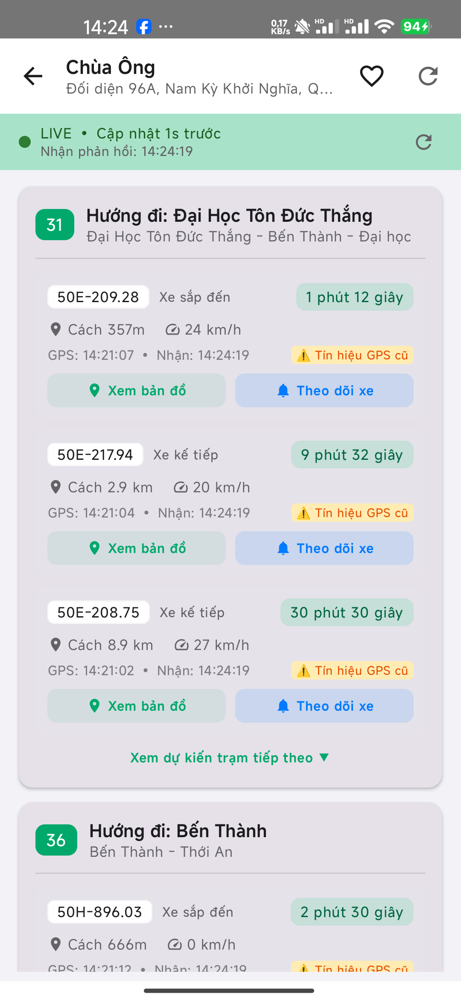 | 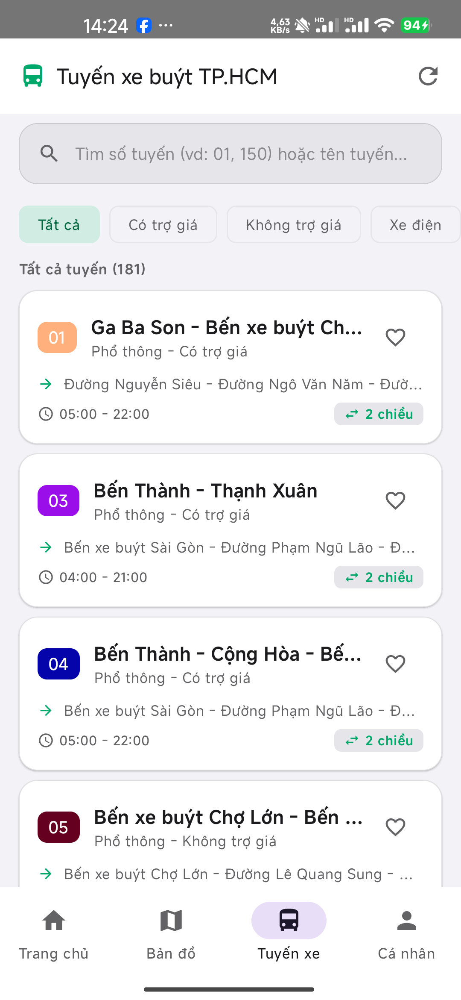 | 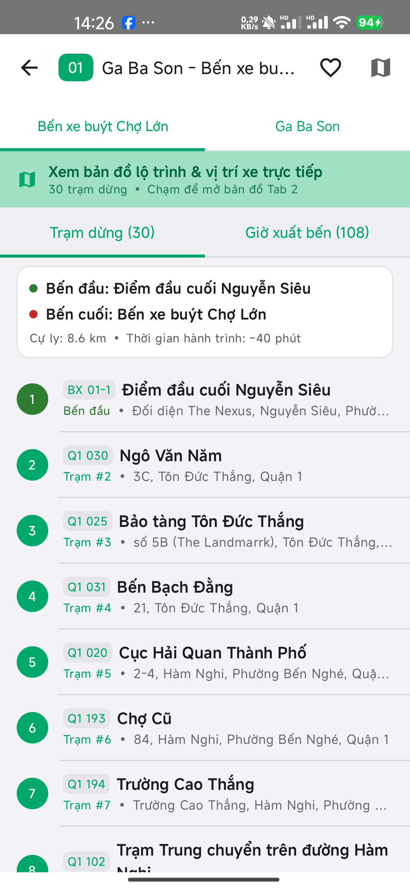 |

| Tra cứu Xe đang hoạt động (UI-006) | Cài đặt Giao diện tối (Dark Mode) | Bản đồ Vector trong Chế độ Tối |
| :---: | :---: | :---: |
| 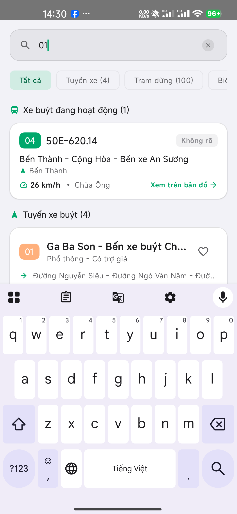 | 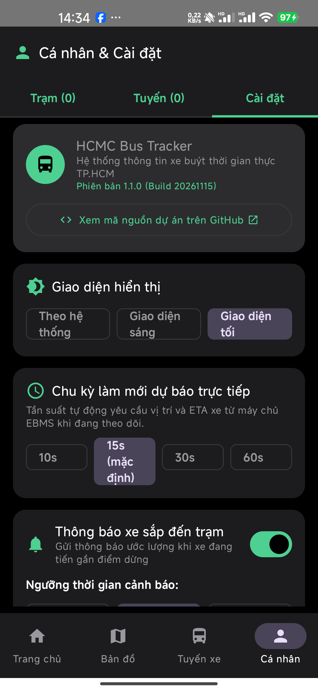 | 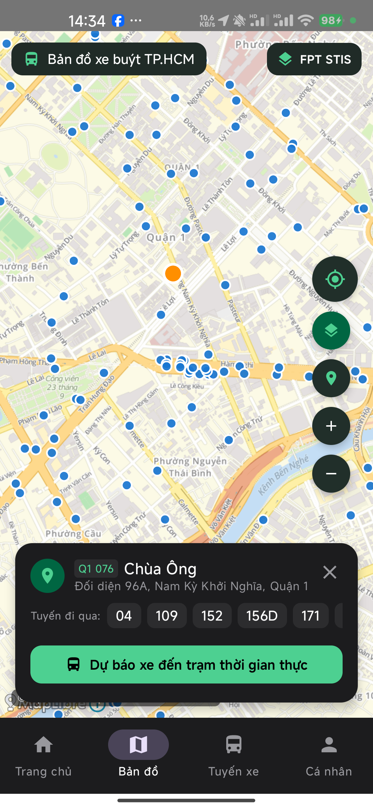 |

---

### Thiết kế Marker Xe buýt Top-Down Bus Coach (Map Engine)

| Zoom thấp (Nhiều xe & Cluster) | Chọn xe chồng lấn (Bottom Sheet) | Xe được chọn & Nhãn đầy đủ | Zoom trung bình (Nhãn rút gọn) |
| :---: | :---: | :---: | :---: |
| 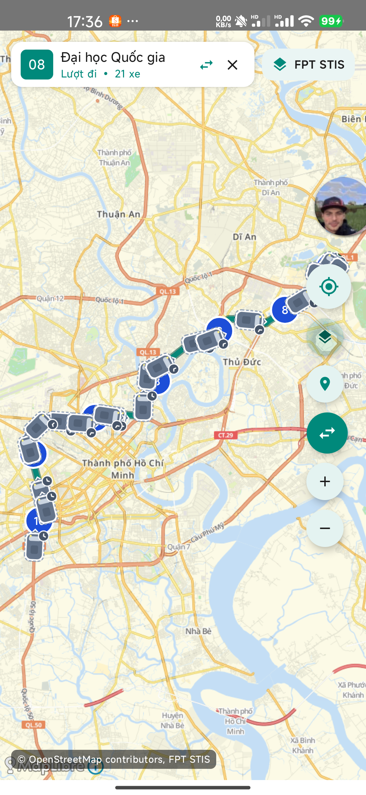 |  | 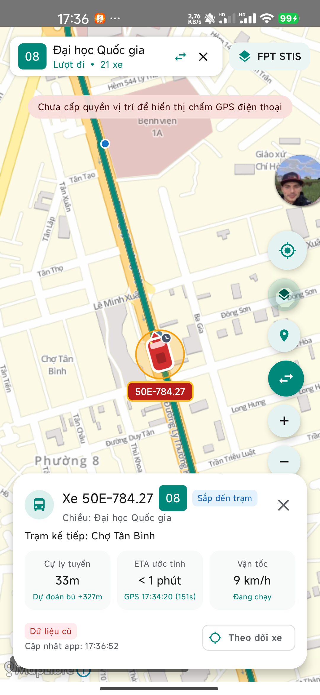 |  |

---

## 4. TÍNH NĂNG CHÍNH / KEY FEATURES

### Bản đồ Trực quan & Marker Top-Down Bus Coach
- **Biểu tượng xe buýt nhìn từ trên xuống (`Top-Down Coach`):** Chuẩn kích thước `dp` nhất quán mọi mật độ (`mdpi` 160 – `xxxhdpi` 640), gồm thân xe (`38 dp` thường / `50 dp` khi chọn + halo hổ phách `58.8 dp`), kính trước, đèn đầu, điều hòa nóc, bóng đổ và mũi định hướng tách biệt hoàn toàn với mũi tên một chiều trên tile bản đồ.
- **Xoay hướng mượt & trung thực:** Nội suy cung tròn ngắn nhất qua biên `0° / 360°` (`BearingSmoother`), ẩn mũi hướng khi `hasValidHeading = false`, phân biệt trạng thái `ACTIVE`, `DELAYED`, `STALE_OR_HELD` và huy hiệu góc (`ARRIVING`, `AT_STOP`, `PASSED`, `STALE_CLOCK`).
- **Nhãn biển số thích ứng 3 mức zoom:** Ẩn ở zoom thấp (`< 13.0`), rút gọn ở zoom trung bình (`13.0..14.8`, VD: `784.27`), đầy đủ ở zoom cao (`>= 14.8` hoặc xe đang chọn, VD: `50E-784.27`), chống va chạm nhãn.
- **Tụ điểm trạm & chọn xe chồng lấn:** Gom nhóm trạm (`clusterMaxZoom = 13`), bộ giải quyết chạm 44 dp + Bottom Sheet **Chọn xe đang gần nhau** (`VehicleOverlapPickerSheet`) không làm lệch tọa độ GPS thật, thứ tự lớp Z 11 tầng (`MapLayerManager`) giữ chấm vị trí người dùng luôn nổi trên cùng.

### Bù trễ GPS & Thu thập Dữ liệu Đa luồng
- **GPS Latency Compensation & Interpolation:** `PositionCompensationEngine` và `VehicleInterpolationEngine` phân loại độ tươi `dts`, bù trễ có giới hạn trên polyline ($d_{\text{proj}} = d_{\text{raw}} - v \times \Delta t$) và giữ vị trí hợp lệ cuối khi dữ liệu cũ/đứng yên.
- **Adaptive Concurrent Polling:** `GlobalPollingCoordinator`, `AdaptiveConcurrencyController`, `SharedStopCoalescer` và `VehicleDataMerger` gộp checkpoint dùng chung và điều chỉnh luồng polling kiểm soát 429/5xx.
- **Camera State Machine ổn định:** Chuyển mượt giữa `FOCUS_VEHICLE`, `FOLLOW_VEHICLE`, `USER_CONTROLLED` (tạm dừng khi kéo bản đồ) và `IDLE`.

### Tra cứu Lộ trình, Dự báo ETA, Tìm kiếm & Cá nhân hóa
- **Danh mục & Chi tiết tuyến (`:feature-route`):** Hơn 180 tuyến nội thành/liên tỉnh TP.HCM, chiều đi/về (`RouteVariant`), giờ hoạt động, cự ly, giá vé và danh sách trạm tuần tự.
- **Tìm kiếm tiếng Việt thông minh (`:feature-search`):** Hơn 6.000 điểm dừng, chuẩn hóa có dấu/không dấu (`VietnameseNormalizer`), tra cứu xe theo biển số (`LicensePlateNormalizer`) và lưu lịch sử tìm kiếm.
- **Dự báo ETA thời gian thực (`:feature-prediction`):** Khoảng cách, ETA, biển số, tốc độ, tuổi GPS (`predictbystopid` / `predictnextstops`), cảnh báo minh bạch dữ liệu cũ.
- **Cá nhân hóa & Thông báo:** Lưu tuyến/trạm yêu thích (Room Database v3), cài đặt chu kỳ polling (`10s / 15s / 30s / 60s`), thông báo xe đến trạm (`POST_NOTIFICATIONS` Android 13+, cooldown 5 phút, lọc GPS cũ > 180s), giao diện Sáng / Tối / Theo hệ thống.

---

## 5. QUYỀN RIÊNG TƯ & BẢO VỆ DỮ LIỆU / PRIVACY & DATA PROTECTION

> 🛡️ **BÁO CÁO MINH CHỨNG AN TOÀN ĐỘC LẬP / INDEPENDENT VERIFICATION REPORT:**  
> Xem chi tiết kết quả từ 7 công cụ đo kiểm mã nguồn, phân tích bytecode DEX tệp APK, rà soát 13 API endpoints và 10 bảng cơ sở dữ liệu Room tại:  
> 👉 **[BÁO CÁO KIỂM CHỨNG AN TOÀN & QUYỀN RIÊNG TƯ (SECURITY_AND_PRIVACY_AUDIT.md)](SECURITY_AND_PRIVACY_AUDIT.md)**

### Tóm tắt Minh chứng Kiểm toán (Audit Evidence Highlights)

| Công cụ đo kiểm (Audit Tool) | Chỉ số đạt được (Result) | Minh chứng an toàn & không thu thập dữ liệu |
|---|:---:|---|
| **Android Lint Engine** | **0 Errors** | Không có lỗi bảo mật tĩnh, cấu hình bảo mật mạng chuẩn |
| **Unit Test Suites (259 tests)** | **100% PASS** | 42 suites, 0 failures; đảm bảo độ tin cậy và ổn định logic |
| **APK Bytecode Scanner** | **0 Trackers / 0 Ads** | Quét DEX release APK: 0 Firebase, 0 AdMob, 0 Facebook Ads, 0 Telemetry |
| **Network Endpoints Scanner** | **13 GET / 0 POST** | 100% API tra cứu công khai; không gửi tọa độ GPS người dùng lên server |
| **Room Database Entities Audit** | **0 User Data Tables** | Các thực thể SQLite chỉ lưu danh mục tuyến xe và mã bookmark yêu thích |
| **Merged AndroidManifest Audit** | **Least Privilege** | Không có quyền chạy ngầm (`BACKGROUND_LOCATION`), không đọc danh bạ/bộ nhớ |
| **Secret Scanner & Gitleaks** | **0 Findings** | Toàn bộ tệp mã nguồn sạch, không chứa private keys hoặc secret token |

---

### Tiếng Việt

1. **Không yêu cầu tài khoản (No account required):**
   - Ứng dụng hoàn toàn không có tính năng đăng ký, đăng nhập hay quản lý hồ sơ người dùng. Mọi tính năng tra cứu lộ trình, bản đồ và dự báo ETA đều khả dụng ngay lập tức mà không cần định danh.
2. **Quyền truy cập vị trí (Location Permission):**
   - Ứng dụng chỉ xin cấp quyền vị trí (`ACCESS_FINE_LOCATION` / `ACCESS_COARSE_LOCATION`) để vẽ chấm tròn định vị ("My Location") và căn chỉnh tâm bản đồ theo vị trí của bạn khi bạn nhấn nút định vị.
   - Vị trí chỉ được lắng nghe khi màn hình Bản đồ (`MapScreen`) đang hiển thị trên nền trước (foreground). Luồng nhận vị trí (`LocationCallback`) được hủy đăng ký và dừng hoàn toàn ngay khi người dùng rời màn hình bản đồ hoặc đóng ứng dụng.
   - Tọa độ GPS của người dùng chỉ tồn tại tạm thời trong bộ nhớ RAM, **không bao giờ** được lưu trữ xuống cơ sở dữ liệu Room/SQLite, **không ghi vào tệp log**, và **tuyệt đối không truyền gửi** đến máy chủ EBMS hay bất kỳ bên thứ ba nào.
   - Ứng dụng không yêu cầu quyền vị trí chạy ngầm (`ACCESS_BACKGROUND_LOCATION`).
3. **Dữ liệu yêu thích và cài đặt cá nhân (Favorites & Local Settings):**
   - Danh sách các tuyến xe, trạm dừng đánh dấu yêu thích được lưu cục bộ trong cơ sở dữ liệu Room Database trên thiết bị của bạn.
   - Cài đặt tùy chỉnh (giao diện, tần suất polling) được lưu trong bộ nhớ cục bộ ứng dụng.
   - Dự án không có máy chủ quản trị tài khoản và không có tính năng đồng bộ hóa đám mây (Cloud Sync). Dữ liệu này chỉ nằm trên thiết bị cá nhân của bạn.
4. **Giao tiếp mạng và nhà cung cấp dịch vụ (Network Communication & Third-Party Services):**
   - Ứng dụng gửi yêu cầu trực tiếp từ thiết bị của bạn đến cổng thông tin EBMS (`https://apicms.ebms.vn`) để tải lộ trình, danh sách trạm và dữ liệu phương tiện thời gian thực qua giao thức HTTPS an toàn.
   - Ứng dụng tải các mảnh bản đồ số (raster tiles) từ máy chủ OpenStreetMap / FPT STIS qua giao thức mạng tiêu chuẩn.
5. **Không quảng cáo & không theo dõi hành vi (No Ads & No Analytics SDKs):**
   - Dự án không tích hợp bất kỳ bộ công cụ phân tích hành vi nào (như Google Analytics, Firebase Analytics, AppsFlyer, Mixpanel).
   - Dự án không tích hợp bất kỳ mạng lưới quảng cáo nào (như AdMob, Unity Ads, AppLovin).
   - Không có mã theo dõi hoặc tạo dấu vân tay thiết bị (device fingerprinting).

---

## 6. KIẾN TRÚC MODULE / PROJECT ARCHITECTURE

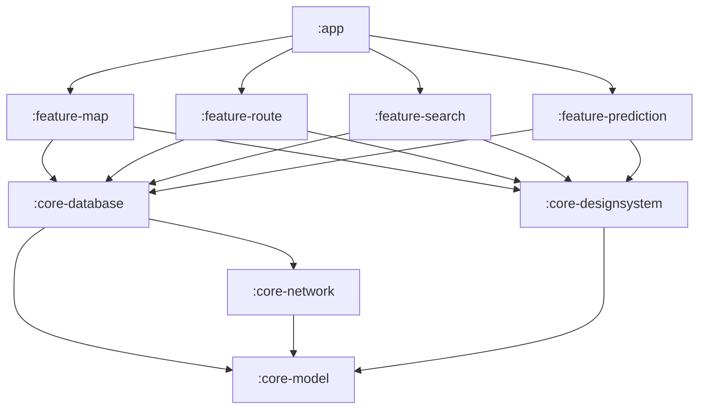

- **`:core-model`:** Domain models, `PositionCompensationEngine`, `ActiveFleetRegistry`, `LicensePlateNormalizer`, `SearchHistory`, `VehicleDataMerger`, `VietnameseNormalizer`.
- **`:core-network`:** Retrofit 2, OkHttp 3, Kotlinx Serialization, `GlobalPollingCoordinator`, `AdaptiveConcurrencyController`, `SharedStopCoalescer`.
- **`:core-database`:** Room Database v3, SQLite DAOs, `BusRepository`, `StaticDatasetManager`.
- **`:core-designsystem`:** Jetpack Compose Material 3 components, Design Tokens, Dimens, Typography, Color Palettes (Light & Dark).
- **`:feature-map`:** `MapScreen`, `MapViewModel`, `VehicleInterpolationEngine`, `VehicleMarkerBitmapFactory`, `MapLayerManager`, `VehicleRenderDiffer`, `VehicleTrackingSheet`.
- **`:feature-route`:** Danh sách 181 tuyến, chi tiết lộ trình và biến thể lượt đi/lượt về.
- **`:feature-search`:** Tìm kiếm tuyến, trạm, biển số xe với debounce và chuẩn hóa tiếng Việt.
- **`:feature-prediction`:** Dự báo ETA thời gian thực, cá nhân hóa, quản lý thông báo xe sắp đến trạm.
- **`:app`:** Application (`HcmcBusTrackerApp`), Hilt DI, `MainActivity` NavHost & NavigationShell.

---

## 7. HƯỚNG DẪN BUILD & PHÁT TRIỂN / BUILD & DEVELOPMENT

- **Môi trường phát triển:** Android Studio Ladybug / Meerkat trở lên.
- **JDK:** Java 21 (sử dụng Android Studio JBR 21 hoặc OpenJDK 21).
- **Android SDK:** `compileSdk = 35`, `minSdk = 26` (Android 8.0 trở lên), `targetSdk = 35`.

### Kiểm thử Toàn bộ Unit Tests
```powershell
.\gradlew.bat testDebugUnitTest
```

### Kiểm tra Android Lint
```powershell
.\gradlew.bat lintDebug
```

### Đóng gói Release APK đã ký số
1. Cấu hình thông tin keystore trong `keystore.properties` (hoặc biến môi trường `HCMC_RELEASE_*`).
2. Biên dịch bản Release:
   ```powershell
   .\gradlew.bat assembleRelease
   ```
*Tệp kết quả: `app/build/outputs/apk/release/app-release.apk`*

---

## 8. GIẤY PHÉP & NGUỒN TÀI NGUYÊN / LICENSES & ATTRIBUTIONS

- **Dữ liệu giao thông công cộng:** Cổng dữ liệu EBMS - Trung tâm Quản lý Giao thông công cộng TP.HCM (`buyttphcm.com.vn`).
- **Dữ liệu bản đồ số:** © [OpenStreetMap contributors](https://www.openstreetmap.org/copyright), FPT STIS.
- **Bộ công cụ hiển thị bản đồ:** [MapLibre Native SDK for Android](https://github.com/maplibre/maplibre-native) (`11.5.2`) - Bản quyền theo giấy phép nguồn mở BSD / Apache 2.0.
