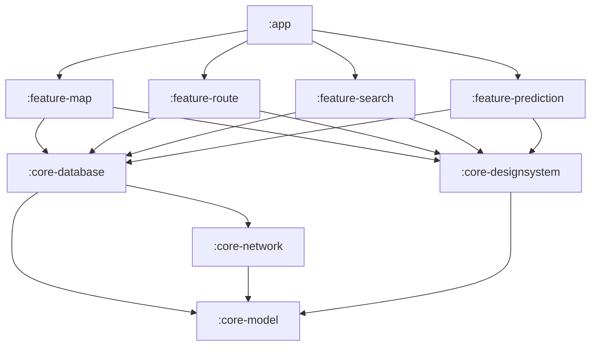

# HCMC Bus Tracker

Ứng dụng Android tra cứu lộ trình, theo dõi vị trí xe buýt và dự báo thời gian đến trạm tại Thành phố Hồ Chí Minh với độ tin cậy cao.

*An open-source, privacy-conscious Android application for tracking public transit buses, routes, and arrival predictions in Ho Chi Minh City.*

---

## 1. TỔNG QUAN / OVERVIEW

Ứng dụng sử dụng nguồn dữ liệu mở/công khai từ hệ thống EBMS của Trung tâm Quản lý Giao thông công cộng TP.HCM (`https://apicms.ebms.vn`) kết hợp nền tảng bản đồ số nguồn mở **MapLibre Native SDK** (`11.5.2`) và nguồn bản đồ nền **OpenStreetMap / FPT STIS**.

- **Phiên bản hiện tại:** `v1.0.0`
- **Kiểm thử tự động:** 36 test suites / 191 unit tests PASS, Android Lint passed.
- **Nghiệm thu thiết bị thật:** Đã nghiệm thu hiển thị và tương tác trên thiết bị Android (`Xiaomi M2102J2SC`, Android 13, 440 dpi).
- **Tải bản phát hành:** Tải APK chính thức đã ký số tại [GitHub Releases](https://github.com/thuanmazda/hcmc-bus-tracker/releases).

---

## 2. TÍNH NĂNG CHÍNH / KEY FEATURES

### Bản đồ Trực quan & Marker Top-Down Bus Coach
- **Biểu tượng xe buýt nhìn từ trên xuống (`Top-Down Coach`):** Chuẩn kích thước `dp` nhất quán mọi mật độ (`mdpi` 160 – `xxxhdpi` 640), gồm thân xe (`38 dp` thường / `50 dp` khi chọn + halo hổ phách `58.8 dp`), kính trước, đèn đầu, điều hòa nóc, bóng đổ và mũi định hướng tách biệt hoàn toàn với mũi tên một chiều trên tile bản đồ.
- **Xoay hướng mượt & trung thực:** Nội suy cung tròn ngắn nhất qua biên `0° / 360°` (`BearingSmoother`), ẩn mũi hướng khi `hasValidHeading = false`, phân biệt trạng thái `ACTIVE`, `DELAYED`, `STALE_OR_HELD` và huy hiệu góc (`ARRIVING`, `AT_STOP`, `PASSED`, `STALE_CLOCK`).
- **Nhãn biển số thích ứng 3 mức zoom:** Ẩn ở zoom thấp (`< 13.0`), rút gọn ở zoom trung bình (`13.0..14.8`, VD: `784.27`), đầy đủ ở zoom cao (`>= 14.8` hoặc xe đang chọn, VD: `50E-784.27`), chống va chạm nhãn.
- **Tụ điểm trạm & chọn xe chồng lấn:** Gom nhóm trạm (`clusterMaxZoom = 13`), bộ giải quyết chạm 44 dp + Bottom Sheet **Chọn xe đang gần nhau** (`VehicleOverlapPickerSheet`) không làm lệch tọa độ GPS thật, thứ tự lớp Z 11 tầng (`MapLayerManager`) giữ chấm vị trí người dùng luôn nổi trên cùng.

### Bù trễ GPS & Thu thập Dữ liệu Đa luồng
- **GPS Latency Compensation & Interpolation:** `PositionCompensationEngine` và `VehicleInterpolationEngine` phân loại độ tươi `dts`, bù trễ có giới hạn trên polyline và giữ vị trí hợp lệ cuối khi dữ liệu cũ/đứng yên.
- **Adaptive Concurrent Polling:** `GlobalPollingCoordinator`, `AdaptiveConcurrencyController`, `SharedStopCoalescer` và `VehicleDataMerger` gộp checkpoint dùng chung và điều chỉnh luồng polling kiểm soát 429/5xx.
- **Camera State Machine ổn định:** Chuyển mượt giữa `FOCUS_VEHICLE`, `FOLLOW_VEHICLE`, `USER_CONTROLLED` (tạm dừng khi kéo bản đồ) và `IDLE`.

### Tra cứu Lộ trình, Dự báo ETA, Tìm kiếm & Cá nhân hóa
- **Danh mục & Chi tiết tuyến (`:feature-route`):** Hơn 130 tuyến nội thành/liên tỉnh TP.HCM, chiều đi/về (`RouteVariant`), giờ hoạt động, cự ly, giá vé và danh sách trạm tuần tự.
- **Tìm kiếm tiếng Việt thông minh (`:feature-search`):** Hơn 6.000 điểm dừng, chuẩn hóa có dấu/không dấu (`VietnameseNormalizer`), debounce 300ms.
- **Dự báo ETA thời gian thực (`:feature-prediction`):** Khoảng cách, ETA, biển số, tốc độ, tuổi GPS (`predictbystopid` / `predictnextstops`), cảnh báo minh bạch dữ liệu cũ.
- **Cá nhân hóa & Thông báo:** Lưu tuyến/trạm yêu thích (Room Database v2), cài đặt chu kỳ polling (`10s / 15s / 30s / 60s`), thông báo xe đến trạm (`POST_NOTIFICATIONS` Android 13+, cooldown 5 phút, lọc GPS cũ > 180s), giao diện Sáng / Tối / Theo hệ thống.

---

## 3. HÌNH ẢNH NGHIỆM THU / SCREENSHOTS

| Zoom thấp (Nhiều xe & Cluster) | Chọn xe chồng lấn (Bottom Sheet) | Xe được chọn & Nhãn đầy đủ | Zoom trung bình (Nhãn rút gọn) |
| :---: | :---: | :---: | :---: |
|  |  |  |  |

---

## 4. QUYỀN RIÊNG TƯ & BẢO VỆ DỮ LIỆU / PRIVACY & DATA PROTECTION

Dự án cam kết minh bạch về cách thức xử lý dữ liệu dựa trên kiểm chứng trực tiếp từ mã nguồn:

### Tiếng Việt

1. **Không yêu cầu tài khoản (No account required):**
   - Ứng dụng hoàn toàn không có tính năng đăng ký, đăng nhập hay quản lý hồ sơ người dùng. Mọi tính năng tra cứu lộ trình, bản đồ và dự báo ETA đều khả dụng ngay lập tức mà không cần định danh.
2. **Quyền truy cập vị trí (Location Permission):**
   - Ứng dụng chỉ xin cấp quyền vị trí (`ACCESS_FINE_LOCATION` / `ACCESS_COARSE_LOCATION`) để vẽ chấm tròn định vị ("My Location") và căn chỉnh tâm bản đồ theo vị trí của bạn khi bạn nhấn nút định vị.
   - Vị trí chỉ được lắng nghe khi màn hình Bản đồ (`MapScreen`) đang hiển thị trên nền trước (foreground). Luồng nhận vị trí (`LocationCallback`) được hủy đăng ký và dừng hoàn toàn ngay khi người dùng rời màn hình bản đồ hoặc đóng ứng dụng.
   - Tọa độ GPS của người dùng chỉ tồn tại tạm thời trong bộ nhớ RAM, **không bao giờ** được lưu trữ xuống cơ sở dữ liệu Room/SQLite, **không ghi vào tệp log**, và **tuyệt đối không truyền gửi** đến máy chủ EBMS hay bất kỳ bên thứ ba nào.
   - Ứng dụng không yêu cầu quyền vị trí chạy ngầm (`ACCESS_BACKGROUND_LOCATION`).
3. **Dữ liệu yêu thích và cài đặt cá nhân (Favorites & Local Settings):**
   - Danh sách các tuyến xe, trạm dừng đánh dấu yêu thích được lưu cục bộ trong cơ sở dữ liệu Room Database trên thiết bị của bạn (`/data/data/com.hcmc.bustracker/databases/`).
   - Cài đặt tùy chỉnh (giao diện, tần suất polling) được lưu trong bộ nhớ cục bộ ứng dụng.
   - Dự án không có máy chủ quản trị tài khoản và không có tính năng đồng bộ hóa đám mây (Cloud Sync). Dữ liệu này chỉ nằm trên thiết bị cá nhân của bạn.
4. **Giao tiếp mạng và nhà cung cấp dịch vụ (Network Communication & Third-Party Services):**
   - Ứng dụng gửi yêu cầu trực tiếp từ thiết bị của bạn đến cổng thông tin EBMS (`https://apicms.ebms.vn`) để tải lộ trình, danh sách trạm và dữ liệu phương tiện thời gian thực.
   - Ứng dụng tải các mảnh bản đồ số (raster tiles) từ máy chủ OpenStreetMap / FPT STIS qua giao thức mạng tiêu chuẩn.
   - *Lưu ý về siêu dữ liệu đường truyền:* Khi thiết bị gửi yêu cầu qua mạng Internet, các máy chủ nhận kết nối (EBMS, OSM) sẽ ghi nhận các siêu dữ liệu kỹ thuật tiêu chuẩn của giao thức TCP/IP/HTTPS như địa chỉ IP của thiết bị, thời gian truy vấn và thông số User-Agent. Ứng dụng không thể can thiệp vào nhật ký kết nối mạng tầng giao vận của các máy chủ này.
5. **Không quảng cáo & không theo dõi hành vi (No Ads & No Analytics SDKs):**
   - Dự án không tích hợp bất kỳ bộ công cụ phân tích hành vi nào (như Google Analytics, Firebase Analytics, AppsFlyer, Mixpanel).
   - Dự án không tích hợp bất kỳ mạng lưới quảng cáo nào (như AdMob, Unity Ads, AppLovin).
   - Không có mã theo dõi hoặc tạo dấu vân tay thiết bị (device fingerprinting).
6. **Thời gian lưu trữ & Xóa dữ liệu (Data Retention & Clearing):**
   - Dữ liệu vị trí người dùng chỉ tồn tại tạm thời trong RAM của phiên chạy hiện tại.
   - Dữ liệu cục bộ (tuyến/trạm yêu thích, bộ nhớ đệm lộ trình) được giữ trên thiết bị cho đến khi người dùng chủ động gỡ cài đặt ứng dụng hoặc chọn **"Xóa dữ liệu / Xóa bộ nhớ lưu trữ" (Clear Storage)** trong mục Quản lý ứng dụng của cài đặt hệ thống Android.
7. **Quyền kiểm soát của người dùng (User Control):**
   - Quyền truy cập vị trí và quyền thông báo (`POST_NOTIFICATIONS` trên Android 13+) là hoàn toàn không bắt buộc.
   - Kể cả khi từ chối cấp quyền vị trí, người dùng vẫn sử dụng đầy đủ 100% tính năng tra cứu danh mục tuyến, xem lộ trình, xem danh sách trạm dừng, theo dõi vị trí xe buýt trên bản đồ và xem dự báo ETA.

---

### English Summary

- **Zero Account Obligation:** No registration, login, or authentication required. All features operate anonymously.
- **Location Privacy:** Coarse/Fine location is used strictly foreground in `MapScreen` to draw user position. Coordinates are kept in RAM only, stopped immediately on exit, never written to Room/SQLite database or persistent logs, and never transmitted to EBMS or any third-party backend. Background location permission is not requested.
- **Strictly Local Storage:** Favorite routes, favorite stops, and user preferences are stored in on-device Room DB / SharedPreferences. No remote cloud sync exists.
- **Network Transparency:** Direct queries to public EBMS API (`https://apicms.ebms.vn`) and OpenStreetMap tiles. Standard transport-level network metadata (IP address, timestamps) is processed by external servers as part of standard HTTPS handshakes.
- **No Trackers, No Ads:** Zero third-party analytics SDKs (no Firebase, no telemetry) and zero advertising frameworks.
- **User Agency:** Users retain full control to toggle or revoke runtime permissions at any time in Android Settings without forfeiting core bus-tracking utilities.

---

## 5. BẢO MẬT HỆ THỐNG / SECURITY STATEMENT

- **Không nhúng bí mật đặc quyền:** Mã nguồn và tệp APK phát hành không chứa mật khẩu cá nhân, khóa bí mật truy cập cơ sở hạ tầng (private credentials), chứng thư số cá nhân hay mã định danh đặc quyền.
- **Quét mã & Phát hiện rò rỉ tự động:** Dự án áp dụng quy trình kiểm tra mã nguồn tự động qua GitHub Actions với bộ công cụ phát hiện secret (Gitleaks, Static Scanning) trên mọi nhánh và pull request.
- **Kiểm soát tính phụ thuộc (Dependencies):** Các thư viện nguồn mở phụ thuộc được rà soát phiên bản và kiểm tra cảnh báo lỗ hổng định kỳ.
- **Báo cáo sự cố bảo mật:** Nếu phát hiện vấn đề an toàn thông tin hoặc lỗ hổng tiềm ẩn, vui lòng thông báo bảo mật qua kênh **GitHub Security Advisories** của repository hoặc liên hệ qua Issues công khai.

---

## 6. TUYÊN BỐ MIỄN TRỪ TRÁCH NHIỆM / DISCLAIMER

- **Dự án độc lập:** HCMC Bus Tracker là dự án công cụ tiện ích mã nguồn mở độc lập, phi lợi nhuận phục vụ cộng đồng, không phải là ứng dụng chính thức do cơ quan quản lý nhà nước hay đơn vị điều hành giao thông công cộng TP.HCM trực tiếp bảo trợ phát hành.
- **Phụ thuộc dữ liệu nguồn:** Thông tin vị trí phương tiện, lộ trình và dự báo giờ đến trạm phụ thuộc hoàn toàn vào dữ liệu cung cấp bởi hệ thống cổng thông tin EBMS. Do hạn chế về độ trễ truyền dữ liệu GPS và tần suất cập nhật từ thiết bị giám sát hành trình của đơn vị vận tải, ứng dụng không cam kết tính tức thời tuyệt đối của mọi phương tiện trên thực địa. Người dùng được khuyến nghị chủ động kết hợp quan sát thực tế khi đón xe.
- **Giới hạn phạm vi bảo mật (Privacy Limitations):** Các cam kết về bảo mật và riêng tư được áp dụng cho phạm vi xử lý bên trong ứng dụng client. Ứng dụng không chịu trách nhiệm và không có quyền can thiệp đối với các chính sách xử lý mạng của nhà cung cấp dịch vụ viễn thông, hệ điều hành Android hoặc máy chủ hạ tầng bên thứ ba khi xử lý lưu lượng mạng tiêu chuẩn.

---

## 7. KIẾN TRÚC MODULE / PROJECT ARCHITECTURE



- **`:core-model`:** Domain models, `PositionCompensationEngine`, `VehicleDataMerger`, `VietnameseNormalizer`.
- **`:core-network`:** Retrofit 2, OkHttp 3, Kotlinx Serialization, `GlobalPollingCoordinator`, `AdaptiveConcurrencyController`, `SharedStopCoalescer`.
- **`:core-database`:** Room Database v2, SQLite DAOs, `BusRepository`, `StaticDatasetManager`.
- **`:core-designsystem`:** Jetpack Compose Material 3 components, Brand colors, Typography, Theming.
- **`:feature-map`:** `MapScreen`, `MapViewModel`, `VehicleInterpolationEngine`, `VehicleMarkerBitmapFactory`, `MapLayerManager`, `VehicleRenderDiffer`, `VehicleOverlapPicker`.
- **`:feature-route`:** Danh sách tuyến, chi tiết lộ trình và biến thể lượt đi/lượt về.
- **`:feature-search`:** Tìm kiếm tuyến/trạm với debounce và chuẩn hóa tiếng Việt.
- **`:feature-prediction`:** Dự báo ETA thời gian thực, cá nhân hóa, quản lý thông báo.
- **`:app`:** Application (`HcmcBusTrackerApp`), Hilt DI, `MainActivity` NavHost & NavigationShell.

---

## 8. HƯỚNG DẪN BUILD & PHÁT TRIỂN / BUILD & DEVELOPMENT

- **Môi trường phát triển:** Android Studio Ladybug / Meerkat trở lên.
- **JDK:** Java 21 (sử dụng Android Studio JBR 21 hoặc OpenJDK 21).
- **Android SDK:** `compileSdk = 35`, `minSdk = 26` (Android 8.0 trở lên), `targetSdk = 35`.

### Kiểm thử Unit Tests
```powershell
.\gradlew.bat testDebugUnitTest
```

### Kiểm tra Android Lint
```powershell
.\gradlew.bat lintDebug
```

### Đóng gói Debug APK
```powershell
.\gradlew.bat assembleDebug
```
*Tệp kết quả: `app/build/outputs/apk/debug/app-debug.apk`*

### Đóng gói Release APK đã ký số
1. Tạo tệp cấu hình chữ ký từ bản mẫu:
   ```powershell
   Copy-Item "keystore.properties.example" "keystore.properties"
   ```
2. Điền đường dẫn tệp keystore phát hành (`storeFile`) và mật khẩu trong `keystore.properties` (tệp này được `.gitignore` bảo vệ tuyệt đối, không đưa vào git).
3. Biên dịch bản Release:
   ```powershell
   .\gradlew.bat assembleRelease
   ```
*Tệp kết quả: `app/build/outputs/apk/release/app-release.apk`*

---

## 9. GIẤY PHÉP & NGUỒN TÀI NGUYÊN / LICENSES & ATTRIBUTIONS

- **Dữ liệu giao thông công cộng:** Cổng dữ liệu EBMS - Trung tâm Quản lý Giao thông công cộng TP.HCM (`buyttphcm.com.vn`).
- **Dữ liệu bản đồ số:** © [OpenStreetMap contributors](https://www.openstreetmap.org/copyright), FPT STIS.
- **Bộ công cụ hiển thị bản đồ:** [MapLibre Native SDK for Android](https://github.com/maplibre/maplibre-native) (`11.5.2`) - Bản quyền theo giấy phép nguồn mở BSD / Apache 2.0.
