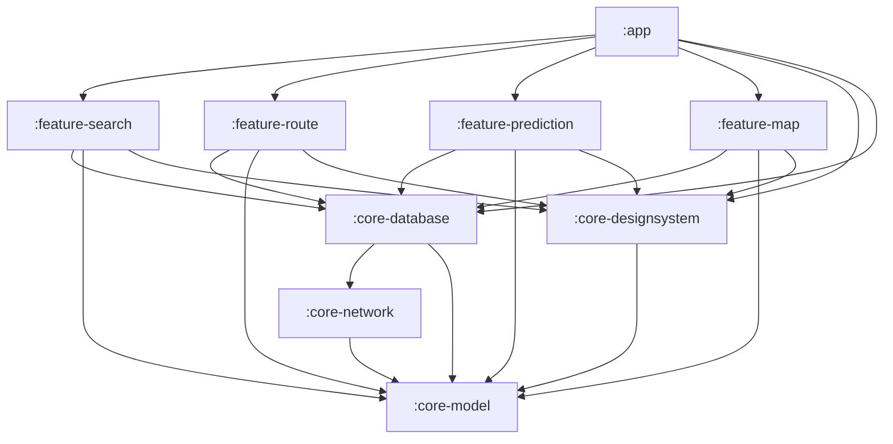
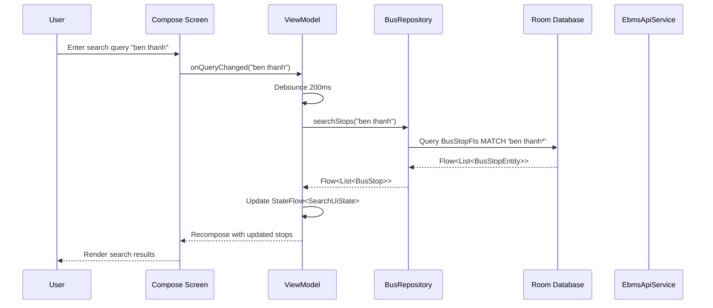

# HCMC BUS TRACKER – PHASE 1 ARCHITECTURE SPECIFICATION

> **Version:** 1.0.0  
> **Package:** `com.hcmcbustracker.app`  
> **Status:** Approved & Implemented  
> **Min SDK:** 26 | **Target/Compile SDK:** 35 | **JDK:** 21 | **Kotlin:** 2.0.21  

---

## 1. Architectural Philosophy & Overview

HCMC Bus Tracker adheres strictly to **Clean Architecture** principles, **Unidirectional Data Flow (UDF)**, and **Separation of Concerns (SoC)** through structured modularization.

### Core Architectural Tenets
1. **Offline-First Strategy**: The application prioritizes local SQLite/Room data as the single source of truth for static transit topology (routes, variants, stops, geopaths). Network requests synchronize data into the database rather than passing raw JSON directly to UI consumers.
2. **Strict Domain Decoupling**: Pure domain models in `:core-model` have zero dependencies on Android frameworks, Room annotations, or Retrofit/Serialization DTOs.
3. **Reactive State Management**: Repositories expose immutable `kotlinx.coroutines.flow.Flow` streams. ViewModels transform these flows into strongly-typed `StateFlow<UiState>` instances consumed by Jetpack Compose.
4. **Lifecycle-Aware Realtime Engine**: Polling engines (e.g., realtime vehicle arrival predictions) are tied to screen lifecycles through Compose effects (`DisposableEffect`), eliminating battery and network waste when backgrounded.
5. **Robust Error & Null Safety**: External network payloads from `https://apicms.ebms.vn` are treated as untrusted and safely parsed via `kotlinx.serialization` with default values and custom mappers.

---

## 2. Modularization Graph

The project is structured into focused Gradle modules to isolate responsibilities, optimize incremental build times, and enforce dependency boundaries:

---

## 3. Module Responsibilities & Specifications

### 3.1. `:app`
- **Responsibility:** Application entry point, dependency injection root (`@HiltAndroidApp`), and top-level navigation container.
- **Key Artifacts:**
  - `HcmcBusTrackerApp`: Configures app-wide services and Timber logging.
  - `MainActivity`: Single-activity hosting the Jetpack Compose navigation graph (`NavHost`).
  - Navigation Routes: `BusTrackerDestinations` defining type-safe routing among Search, Route Detail, and Stop Prediction screens.

### 3.2. `:core-model`
- **Responsibility:** Pure Kotlin business models, value objects, string normalization utilities, and generic result containers.
- **Key Artifacts:**
  - `Route`, `RouteVariant`, `BusStop`, `RoutePath`: Core transit entities.
  - `Prediction`, `ArrivalVehicle`: Real-time vehicle arrival forecasting structures.
  - `VietnameseNormalizer`: Text preprocessor removing Vietnamese accents/diacritics and special characters for fast phonetic search.
  - `NetworkResult<T>`: Functional wrapper representing `Success`, `Error`, or `Loading`.

### 3.3. `:core-network`
- **Responsibility:** Remote API communication with `https://apicms.ebms.vn`, JSON serialization, HTTP headers, timeouts, and DTO-to-Domain mappers.
- **Key Artifacts:**
  - `EbmsApiService`: Retrofit interface defining the 5 verified EBMS endpoints (`/businfo/getallroute`, `/businfo/getstopsbyroute`, `/businfo/getroutesbyvar`, `/businfo/getstopinfo`, `/businfo/getpredict`).
  - DTO Models: `RouteDto`, `RouteVariantDto`, `BusStopDto`, `RoutePathDto`, `PredictionDto`.
  - `NetworkModule`: Hilt module provisioning OkHttpClient (connect: 15s, read: 30s) and Kotlinx.Serialization converter (`ignoreUnknownKeys = true`).
  - `SafeApiCall`: Coroutine helper translating HTTP/Network exceptions into standardized `NetworkResult`.

### 3.4. `:core-database`
- **Responsibility:** Local persistence using Room 2.6.1, SQLite FTS4 full-text search, and offline-first repository synchronization engine.
- **Key Artifacts:**
  - `BusTrackerDatabase`: Room database definition featuring entities:
    - `RouteEntity`
    - `RouteVariantEntity`
    - `BusStopEntity` & `BusStopFts`
    - `RouteStopCrossReference`
    - `RoutePathEntity`
    - `FavoriteStopEntity`
    - `SyncMetadataEntity`
  - DAOs: `RouteDao`, `BusStopDao`, `RouteVariantDao`, `RoutePathDao`, `FavoriteStopDao`, `SyncMetadataDao`.
  - `BusRepository` & `BusRepositoryImpl`: Unified interface coordinating network fetches and local transactions.

### 3.5. `:core-designsystem`
- **Responsibility:** Centralized Material Design 3 theme, color palette, typography, shapes, and reusable transit components.
- **Key Artifacts:**
  - Theme: `HcmcBusTheme`, `BusGreen`, `BusBlue`, `BusWarning`, `BusSurface`.
  - Reusable UI Components:
    - `RouteBadge`: Route number chip with custom background badges.
    - `ArrivalTimeChip`: Highlighting ETA in minutes with real-time flashing/urgent states.
    - `LoadingState`: Standard loading spinner and error placeholders.

### 3.6. `:feature-search`
- **Responsibility:** Fast search interface for routes and bus stops.
- **Key Artifacts:**
  - `SearchViewModel`: Debounces user keystrokes (200ms) and executes accent-insensitive FTS queries against SQLite.
  - `SearchScreen`: Jetpack Compose screen with segmented tabs (`Tuyến đường`, `Trạm dừng`), sync status banner, and instant result list.

### 3.7. `:feature-route`
- **Responsibility:** Detailed display of route schedules, outbound/inbound variant switching, and ordered stop sequences.
- **Key Artifacts:**
  - `RouteDetailViewModel`: Coordinates route metadata, variants, stop sequences, and route path polyline coordinates.
  - `RouteDetailScreen`: Outbound/inbound tab bar, operational information card, and vertical timeline stop sequence.

### 3.8. `:feature-prediction`
- **Responsibility:** Real-time arrival predictions at a selected stop.
- **Key Artifacts:**
  - `PredictionViewModel`: Manages 15-second polling interval and 1-second elapsed counter for ETA freshness.
  - `StopPredictionScreen`: Displays approaching vehicles, license plates, distances, and speed, with next-stop expandable forecasting.

### 3.9. `:feature-map`
- **Responsibility:** OpenStreetMap visualization via MapLibre Native SDK, polyline rendering, and vehicle animation.
- **Key Artifacts:**
  - MapLibre raster integration with FPT STIS / OSM tiles and explicit attribution.
  - `VehicleInterpolationEngine`: Dead-reckoning and linear interpolation algorithms calculating smooth vehicle movements between 15-second polling ticks.

---

## 4. Unidirectional Data Flow (UDF) & State Pattern

Every feature screen follows the strict UDF loop:

---

## 5. Security, Privacy & Performance

1. **Zero PII Exposure**: No user tracking or analytics IDs are stored or transmitted.
2. **Prohibited HTTP Body Logging in Production**: OkHttp `HttpLoggingInterceptor` is conditionally bound to `Level.BODY` strictly for `DEBUG` builds; `Level.NONE` is enforced in release builds.
3. **Local Database Concurrency**: Room writes execute within localized coroutine transactions on `Dispatchers.IO`, preventing UI thread stalls.
4. **Resilient Synchronization**: Local data is never purged before network data is successfully downloaded, parsed, and validated.
