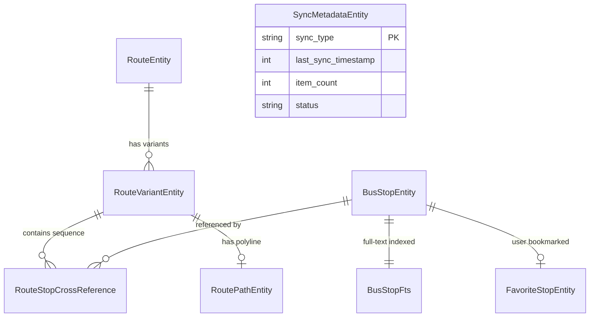

# HCMC BUS TRACKER – PHASE 1 LOCAL DATABASE SCHEMA & ROOM SPECIFICATION

> **Database Version:** 1  
> **Database Name:** `hcmc_bus_tracker.db`  
> **ORM Engine:** Room 2.6.1 with SQLite FTS4  
> **Module:** `:core-database`  

---

## 1. Database Architecture & ER Diagram

The local database serves as the offline-first Single Source of Truth for transit topology. Room is configured with foreign key constraints, composite indices for geo-spatial and sequence queries, and an SQLite FTS4 virtual table for high-speed, accent-insensitive search.



---

## 2. Table Specifications

### 2.1. `routes` (`RouteEntity`)
Stores general route metadata.

| Column | Type | Nullable | Description |
| :--- | :--- | :--- | :--- |
| `route_id` | `INTEGER` | **NO** (PK) | Unique route ID from EBMS. |
| `route_no` | `TEXT` | **NO** | Bus number label (e.g. "01", "150", "D4"). |
| `route_name` | `TEXT` | **NO** | Full route title (e.g. "Bến Thành - Chợ Lớn"). |
| `route_color` | `TEXT` | YES | Hex color code (e.g. "#1E88E5"). |
| `route_type` | `TEXT` | YES | Subsidized or non-subsidized category. |
| `distance_meters` | `REAL` | YES | Route length in meters. |
| `headway` | `TEXT` | YES | Operating interval (e.g. "10-15 phút"). |
| `operation_time` | `TEXT` | YES | Daily schedule (e.g. "05:00 - 20:30"). |
| `outbound_desc` | `TEXT` | YES | Summary of outbound path. |
| `inbound_desc` | `TEXT` | YES | Summary of inbound path. |
| `search_keywords` | `TEXT` | **NO** | Normalized unaccented search keywords. |

*Indices:*
- `index_routes_route_no` on `route_no`
- `index_routes_keywords` on `search_keywords`

---

### 2.2. `route_variants` (`RouteVariantEntity`)
Stores directional variations (outbound vs inbound) for each route.

| Column | Type | Nullable | Description |
| :--- | :--- | :--- | :--- |
| `variant_id` | `INTEGER` | **NO** (PK) | Unique variant ID (`RouteVarId`). |
| `route_id` | `INTEGER` | **NO** (FK) | Reference to `routes(route_id)` (ON DELETE CASCADE). |
| `variant_name` | `TEXT` | **NO** | Descriptive variant name. |
| `short_name` | `TEXT` | **NO** | Short label for tabs. |
| `route_no` | `TEXT` | **NO** | Route number string. |
| `start_stop` | `TEXT` | **NO** | Starting terminal stop name. |
| `end_stop` | `TEXT` | **NO** | Ending terminal stop name. |
| `distance_meters` | `REAL` | **NO** | Length of this specific variant. |
| `is_outbound` | `INTEGER` | **NO** | Boolean flag (`1` for Outbound, `0` for Inbound). |
| `running_time_min` | `INTEGER` | **NO** | Expected duration in minutes. |

*Indices:*
- `index_variants_route_id` on `route_id`

---

### 2.3. `bus_stops` (`BusStopEntity`)
Stores physical bus stop infrastructure across HCMC.

| Column | Type | Nullable | Description |
| :--- | :--- | :--- | :--- |
| `stop_id` | `INTEGER` | **NO** (PK) | Unique bus stop ID. |
| `stop_code` | `TEXT` | **NO** | Bus stop alphanumeric code (e.g. "Q1 001"). |
| `name` | `TEXT` | **NO** | Station or landmark name. |
| `stop_type` | `TEXT` | **NO** | Station classification (Trụ dừng, Nhà chờ, Bến bãi). |
| `zone` | `TEXT` | **NO** | Administrative district/county (Quận 1, Thủ Đức...). |
| `ward` | `TEXT` | YES | Ward (Phường/Xã). |
| `address_no` | `TEXT` | **NO** | Street number. |
| `street` | `TEXT` | **NO** | Street name. |
| `support_disability` | `INTEGER` | **NO** | Accessibility indicator (`1` or `0`). |
| `status` | `TEXT` | **NO** | Operational status ("Active", etc.). |
| `lat` | `REAL` | **NO** | WGS84 Latitude. |
| `lng` | `REAL` | **NO** | WGS84 Longitude. |
| `search_keywords` | `TEXT` | **NO** | Accent-stripped normalized text for queries. |
| `routes_list` | `TEXT` | **NO** | Comma-delimited route codes serving this stop. |

*Indices:*
- `index_stops_code` on `stop_code`
- `index_stops_geo` on `(lat, lng)` (Compound index for Bounding Box map viewport filtering).
- `index_stops_zone` on `zone`

---

### 2.4. `bus_stops_fts` (`BusStopFts`)
SQLite FTS4 virtual table mapping directly to `bus_stops`:

```kotlin
@Entity(tableName = "bus_stops_fts")
@Fts4(contentEntity = BusStopEntity::class)
data class BusStopFts(
    @PrimaryKey
    @ColumnInfo(name = "rowid")
    val rowId: Int,
    val name: String,
    val street: String,
    val search_keywords: String
)
```

Enables near-instantaneous (~1-2ms) match lookups without table scans:
```sql
SELECT bus_stops.* FROM bus_stops
JOIN bus_stops_fts ON bus_stops.stop_id = bus_stops_fts.rowid
WHERE bus_stops_fts MATCH :matchQuery
LIMIT 50;
```

---

### 2.5. `route_stop_cross_ref` (`RouteStopCrossReference`)
Maps ordered stop sequences for each route variant.

| Column | Type | Nullable | Description |
| :--- | :--- | :--- | :--- |
| `route_id` | `INTEGER` | **NO** (FK) | Route reference. |
| `variant_id` | `INTEGER` | **NO** (FK) | Variant reference. |
| `stop_id` | `INTEGER` | **NO** (FK) | Stop reference. |
| `stop_order` | `INTEGER` | **NO** | 1-based sequential order along the route. |

*Primary Key:* `(variant_id, stop_id)`  
*Indices:*
- `index_cross_ref_variant_order` on `(variant_id, stop_order)`

---

### 2.6. `route_paths` (`RoutePathEntity`)
Stores geographic polyline coordinates for map drawing.

| Column | Type | Nullable | Description |
| :--- | :--- | :--- | :--- |
| `variant_id` | `INTEGER` | **NO** (PK) | Variant ID. |
| `route_id` | `INTEGER` | **NO** | Route ID. |
| `latitudes` | `TEXT` | **NO** | Comma-delimited latitude array string. |
| `longitudes` | `TEXT` | **NO** | Comma-delimited longitude array string. |
| `point_count` | `INTEGER` | **NO** | Total coordinates count. |

---

### 2.7. `sync_metadata` (`SyncMetadataEntity`)
Tracks synchronization timestamps and status.

| Column | Type | Nullable | Description |
| :--- | :--- | :--- | :--- |
| `sync_type` | `TEXT` | **NO** (PK) | "ROUTES", "STOPS", "VARIANTS". |
| `last_sync_timestamp` | `INTEGER` | **NO** | Epoch millisecond of last successful sync. |
| `item_count` | `INTEGER` | **NO** | Total items persisted. |
| `status` | `TEXT` | **NO** | "SUCCESS", "FAILED", "IN_PROGRESS". |

---

## 3. Vietnamese Accent Normalization Strategy

Vietnamese text possesses multiple vowel tones and diacritics (e.g. `à, á, ả, ã, ạ, â, ầ, ẩ, đ, ô, ơ, ư`).

`VietnameseNormalizer` strips accents and decomposes characters into standard ASCII lowercase tokens before saving into `search_keywords`:
- Input: `"Bến xe buýt Chợ Lớn, Quận 5"`
- Output: `"ben xe buyt cho lon quan 5"`

Queries are automatically sanitized: searching `"cho lon"` or `"chợ lớn"` produces identical search tokens, yielding 100% recall.
