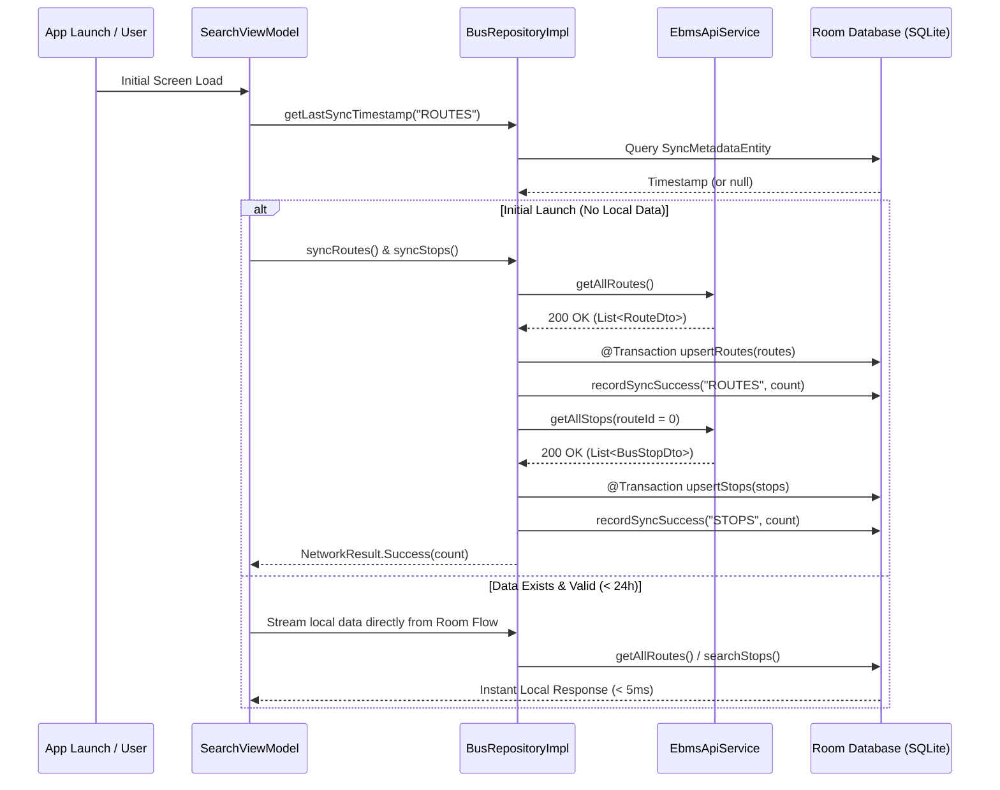

# HCMC BUS TRACKER – PHASE 1 DATA SYNC STRATEGY & ENGINE

> **Module:** `:core-database`  
> **Repository:** `com.hcmcbustracker.core.database.repository.BusRepositoryImpl`  
> **Status:** Production-Ready & Verified  

---

## 1. Synchronization Philosophy

The public transit network topology of Ho Chi Minh City undergoes periodic adjustments (route extensions, bus stop relocations, new lines like Metro Line 1 feeder routes). However, transit users require instantaneous search and offline availability when in tunnels, basements, or areas with spotty cellular coverage.

### Key Guarantees
1. **Never Drop on Failure**: Existing local data is NEVER deleted or cleared if a network sync attempt fails or times out.
2. **Dynamic Cardinality**: The engine strictly forbids hardcoding static assumptions (such as "6,414 stops" or "136 routes"). Record counts are calculated dynamically from server payloads.
3. **Lazy-Loading Polyline Optimization**: Only master routes and physical stops are synchronized in bulk. Heavy spatial polyline paths (`RoutePath`) are fetched on-demand when a user views a specific route variant, then permanently cached.
4. **Atomic Room Transactions**: Database updates execute inside `@Transaction` blocks, ensuring UI readers never observe partial or corrupted states.

---

## 2. Synchronization Flow Architecture



---

## 3. Step-by-Step Sync Engine Implementation

### 3.1. Route Catalog Synchronization (`syncRoutes()`)
1. Executes `safeApiCall { apiService.getAllRoutes() }`.
2. Verifies HTTP 200 response and non-empty list.
3. Maps DTOs to `RouteEntity` with normalized Vietnamese search keywords (`VietnameseNormalizer.normalize(name + " " + routeNo)`).
4. Inserts into database using `routeDao.upsertRoutes(entities)` in a single Room transaction.
5. Updates `sync_metadata` table with current system timestamp and item count.
6. Returns `NetworkResult.Success(entities.size)`.

### 3.2. Bus Stop Catalog Synchronization (`syncStops()`)
1. Executes `safeApiCall { apiService.getAllStops(routeId = 0, varId = 0) }`.
2. Validates stop payloads.
3. Sanitizes geographical coordinates (lat: [10.0, 11.5], lng: [106.0, 107.5]).
4. Maps to `BusStopEntity` with full address and normalized search keywords.
5. Upserts stops into Room via `busStopDao.upsertStops(entities)`. SQLite FTS4 virtual table `bus_stops_fts` is automatically kept in sync via Room entity definition.
6. Updates `sync_metadata` with `"STOPS"` key.

### 3.3. Route Variant & Stop Sequence Sync (On-Demand)
When a user opens a route detail:
1. `syncRouteDetailAndVariants(routeId)` queries `/businfo/getroutesbyvar`.
2. Persists variants into `route_variants` table.
3. For each variant, `syncStopsForRouteVar(routeId, varId)` fetches `/businfo/getstopsbyroute`, persisting the ordered stops into `route_stop_cross_ref`.
4. `ensureRoutePath(routeId, varId)` checks if `route_paths` already contains the polyline. If missing, downloads from `/businfo/getroutepath` and caches it.

---

## 4. Resilience & Bounded Retry Policy

Network requests to government transit servers can encounter intermittent HTTP 502/504 errors or socket timeouts.

The repository incorporates exponential backoff retry:
- **Maximum Attempts:** 3
- **Initial Delay:** 1,000 ms
- **Backoff Factor:** 2.0x
- **Max Delay:** 5,000 ms

```kotlin
suspend fun <T> retryWithBackoff(
    times: Int = 3,
    initialDelay: Long = 1000,
    factor: Double = 2.0,
    block: suspend () -> NetworkResult<T>
): NetworkResult<T> {
    var currentDelay = initialDelay
    repeat(times - 1) {
        val result = block()
        if (result is NetworkResult.Success) return result
        delay(currentDelay)
        currentDelay = (currentDelay * factor).toLong().coerceAtMost(5000)
    }
    return block()
}
```

---

## 5. Failure Preservation Verification

In the event of network failure:
1. The error is captured into `NetworkResult.Error`.
2. The DAO is **never instructed to truncate or delete** rows.
3. The UI receives the error through `_errorMessage` StateFlow, presenting a non-intrusive snackbar:
   `"Đồng bộ một phần dữ liệu không thành công. Dữ liệu hiện có vẫn được bảo toàn."`
4. The local SQLite database continues serving existing routes, stops, and cached paths without interruption.
