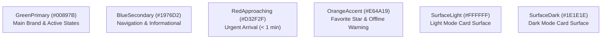
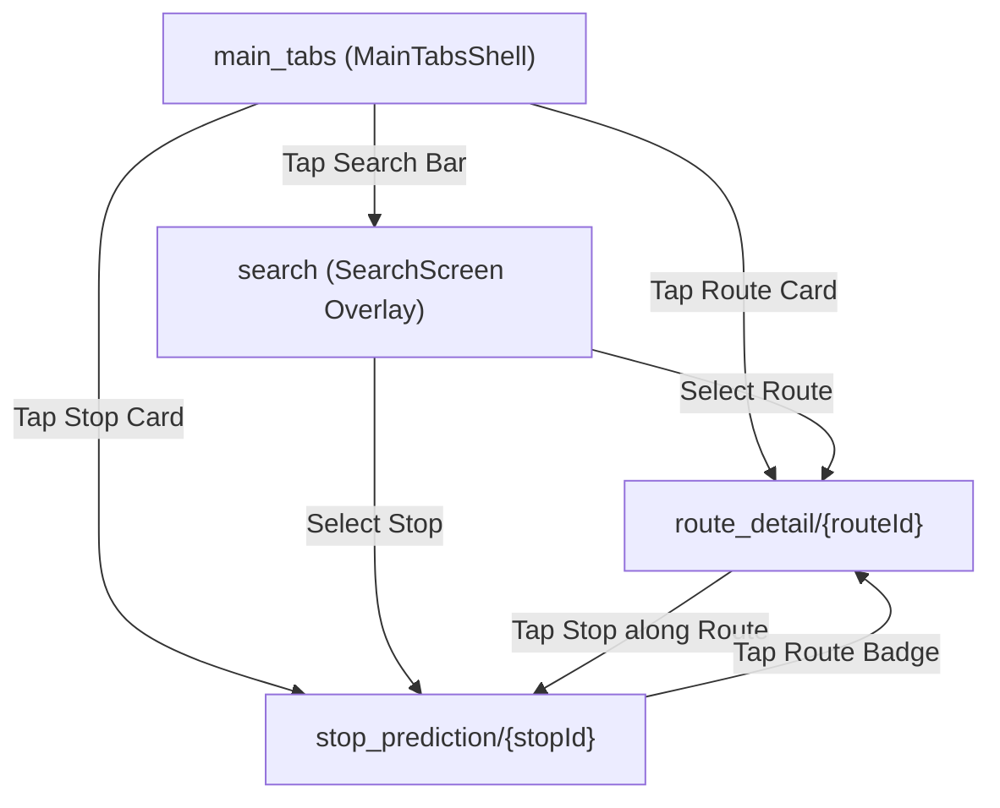

# HCMC BUS TRACKER – PHASE 2 USER INTERFACE & DESIGN SYSTEM GUIDELINES

> **Version:** 2.0.0  
> **Platform:** Android Native (Jetpack Compose & Material Design 3)  
> **Package:** `com.hcmcbustracker.app`  
> **Status:** Implemented & Verified  

---

## 1. Design Direction & Transit UX Principles

The user interface of HCMC Bus Tracker is designed specifically for public transit commuters navigating Ho Chi Minh City's high-density traffic environment. Commuters glance at their phones in bright sunlight, on moving vehicles, or while walking to a bus stop.

### Core Design Tenets
1. **Glanceable & High-Contrast**: Critical information (route numbers, station names, approaching vehicle countdowns) must be legible in under 1 second.
2. **Minimal Friction (Zero-Waste Taps)**: Reaching a live bus arrival forecast requires no more than 2 taps from the home screen.
3. **Phone-First Ergonomics**: Key interactive elements, navigation tabs, and primary action buttons are placed within the thumb zone of modern large smartphones.
4. **Independent Identity**: Distinct, clean visual architecture tailored for HCMC transit; strictly avoids copying legacy MultiGo interfaces while honoring official EBMS transit standards.
5. **Full Light & Dark Theme Parity**: Designed with native Material 3 color roles for both day and night commute conditions.

---

## 2. Color System & Semantic Palette

The theme is declared in `com.hcmcbustracker.core.designsystem.theme` with strict semantic color roles:



### Color Palette Reference

| Role | Light Mode Hex | Dark Mode Hex | Usage |
| :--- | :--- | :--- | :--- |
| **Primary** | `#00897B` | `#4EBAAA` | Brand identity, route badges, active tab indicator. |
| **Secondary** | `#1976D2` | `#63A4FF` | Secondary metadata, direction arrows, links. |
| **Approaching / Urgent** | `#D32F2F` | `#EF5350` | Vehicles arriving in < 1 min or < 300 meters away. |
| **Warning / Offline** | `#E64A19` | `#FF7043` | Offline indicator, network retry alerts, favorite star. |
| **Background** | `#F8F9FA` | `#121212` | App canvas background. |
| **Card Surface** | `#FFFFFF` | `#1E1E1E` | Elevated card containers (`RouteCard`, `StopCard`, `ArrivalCard`). |
| **Surface Variant** | `#F1F3F4` | `#2C2C2C` | Search bar background, chip containers, dividers. |
| **Text Primary** | `#1A1A1A` | `#EDEDED` | Route titles, stop names, headers. |
| **Text Secondary** | `#5F6368` | `#A0A0A0` | Addresses, distance markers, operating times. |

---

## 3. Typography & Visual Hierarchy

The application employs Material 3 typography with customized font weights to emphasize transit identifiers:
- **Route Badges**: `FontWeight.Bold`, `14sp`, colored pill with 6dp rounded corners.
- **Stop Names / Titles**: `FontWeight.SemiBold`, `15sp - 17sp`, `maxLines = 1` with ellipsis.
- **ETA Countdowns**: `FontWeight.Bold`, `13sp`, pill container with 16dp radius.
- **Stop Codes**: `FontWeight.Bold`, `11sp`, badge label `[Q1 001]` for quick field verification.

---

## 4. Reusable Component System (`:core-designsystem`)

All core components are isolated in `:core-designsystem`, thoroughly tested, and accompanied by `@Preview` composables in both Light and Dark themes.

### 4.1. `BusSearchBar`
- **Location:** `com.hcmcbustracker.core.designsystem.component.BusSearchBar`
- **Specifications:**
  - 52dp height, 14dp rounded corners.
  - SurfaceVariant container with subtle elevation.
  - Leading search lens icon and clear (`X`) trailing action when populated.
  - Dual-mode support: directly editable with `BasicTextField` or tap-through click target navigating to search view.

### 4.2. `RouteCard`
- **Location:** `com.hcmcbustracker.core.designsystem.component.RouteCard`
- **Specifications:**
  - 16dp rounded corners, 1.5dp elevation.
  - Displays `RouteBadge` with route number and dynamic hex color parsing.
  - Displays full route name and route category (Phổ thông có trợ giá / Liên tỉnh).
  - Displays terminal stops (Outbound / Inbound direction summary).
  - Operating schedule (e.g. `05:00 - 20:30`) and 2-way direction badge.

### 4.3. `StopCard`
- **Location:** `com.hcmcbustracker.core.designsystem.component.StopCard`
- **Specifications:**
  - 16dp rounded corners, 1.5dp elevation.
  - Station pin icon inside primary-container rounded square.
  - Station code pill `[Q1 001]`, station name, and full address.
  - Horizontally scrollable list of passing `RouteBadge` chips.
  - Integrated favorite toggle button with orange heart indicator.

### 4.4. `ArrivalCard`
- **Location:** `com.hcmcbustracker.core.designsystem.component.ArrivalCard`
- **Specifications:**
  - Real-time prediction card for approaching buses.
  - Displays route badge and destination.
  - License plate pill (`51B-123.45`), vehicle speed (`km/h`), and distance (`m` / `km`).
  - `ArrivalTimeChip` showing minutes to arrival. Flashes urgent red when approaching.

### 4.5. `LoadingState`
- **Specifications:** Centered circular progress indicator with informative transit loading message.

### 4.6. `EmptyState`
- **Specifications:** Circular icon container, bold headline, explanation, and optional action button (e.g. "Xóa tìm kiếm").

### 4.7. `ErrorState`
- **Specifications:** Error icon, descriptive error message (in Vietnamese), and "Thử lại" retry button.

### 4.8. `OfflineBanner`
- **Specifications:** Animated vertical expand/collapse banner informing the user when background sync is active or when offline cached data is in use.

### 4.9. `DesignPreviewData`
- **Location:** `com.hcmcbustracker.core.designsystem.component.PreviewData`
- **Purpose:** Strict isolation of mock transit data strictly for Compose `@Preview` tooling. Never used in production repositories or runtime ViewModels.

---

## 5. Application Shell & Bottom Navigation (4 Tabs)

The application shell in `MainActivity.kt` implements a 4-tab bottom navigation bar using Material 3 `NavigationBar`:

```
+-----------------------------------------------------------+
|                        TOP APP BAR                        |
+-----------------------------------------------------------+
|                                                           |
|                       SCREEN CONTENT                      |
|                                                           |
+-----------------------------------------------------------+
|  [ Bản đồ ]    [ Tuyến xe ]    [ Trạm dừng ]   [ Cá nhân ]|
+-----------------------------------------------------------+
```

### Tab Breakdown

1. **Tab 1: Bản đồ (`NavigationTab.MAP`)**
   - Implemented by `HomeScreen` (`:feature-map`).
   - Top `BusSearchBar` (tapping navigates to instant search).
   - **Khu vực bản đồ xem trước (`MapPreviewCard`)**: MapLibre Native raster map displaying OpenStreetMap tiles centered at central HCMC with OSM attribution. (Phase 2 preview mode; full interactive layer activated in Phase 3).
   - **Lối truy cập nhanh đến dự báo (`QuickPredictionCard`)**: One-tap shortcut directly opening stop prediction.
   - **Trạm yêu thích / Trạm gần đây**: Instant cards for favorite stations.
   - **Tuyến xe phổ biến**: Most frequented lines (01, 150, 56...).

2. **Tab 2: Tuyến xe (`NavigationTab.ROUTES`)**
   - Implemented by `RoutesScreen` (`:feature-route`).
   - Full catalog of bus routes with search by route code (e.g. `01`, `150`, `D4`) and route name.
   - Displays `RouteCard` items with start/end terminals, operating times, and 2-way direction indicator.

3. **Tab 3: Trạm dừng (`NavigationTab.STOPS`)**
   - Implemented by `StopsScreen` (`:feature-search`).
   - Search physical bus stops across HCMC with unaccented Vietnamese search (SQLite FTS4).
   - Quick suggestion chips for landmark hubs: "Bến Thành", "Hàm Nghi", "Chợ Lớn", "Đại học Quốc Gia", "Bến xe Miền Đông".
   - Displays `StopCard` items with address and passing route chips.

4. **Tab 4: Cá nhân (`NavigationTab.PERSONAL`)**
   - Implemented by `PersonalScreen` (`:feature-prediction`).
   - User profile summary.
   - Complete list of bookmarked favorite bus stops with quick prediction access.
   - Offline sync manager: shows last successful sync timestamp, and "Đồng bộ toàn bộ dữ liệu mới nhất" button.
   - Application attribution: EBMS data source and OpenStreetMap license details.

---

## 6. Navigation Architecture

Navigation is managed via Jetpack Navigation Compose (`BusTrackerAppNavHost`):



All route transitions maintain backstack integrity, and tab switching preserves view state across tabs via `rememberSaveable`.
