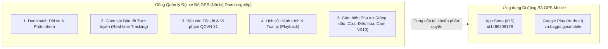

# BÁO CÁO KHẢO SÁT QUYỀN TRUY CẬP VÀ PHẠM VI HỆ THỐNG BA GPS
## TÀI LIỆU DỰ ÁN: HCMC BUS TRACKER – PHIÊN BẢN 1.1.0 (PHASE 13)

---

**Mã tài liệu:** `PHASE_13_ACCESS_AND_SCOPE_REPORT.md`  
**Ngày thực hiện:** Ngày 13 tháng 11 năm 2026  
**Chủ thể khảo sát:** Nhóm Nghiên cứu Kỹ thuật & Kiến trúc Hệ thống (HCMC Bus Tracker Core Team)  
**Trạng thái pháp lý & kỹ thuật:** Nghiên cứu thuần túy (Read-only Investigation) – **TUYỆT ĐỐI KHÔNG TRIỂN KHAI CODE**  
**Địa chỉ khảo sát thực tế:** `https://futagps.binhanh.vn/Default.aspx?LoginErrorMsgID=4`  
**Bằng chứng hình ảnh trực quan:** [ba_gps_login_evidence.png](file:///e:/MultiGo%20Reworked/docs/research/phase-13-ba-gps/ba_gps_login_evidence.png)  

---

## 1. TỔNG QUAN HỆ THỐNG VÀ BỐI CẢNH KHẢO SÁT

Hệ thống **HCMC Bus Tracker (v1.0.0)** hiện đang vận hành ổn định trên nền tảng dữ liệu công cộng của Trung tâm Quản lý Giao thông công cộng TP.HCM (EBMS - `https://apicms.ebms.vn/`).
Đặc điểm kỹ thuật cốt lõi của dữ liệu EBMS là:
- Cung cấp: Biển số xe (`v`), Tốc độ (`s`), Khoảng cách dọc lộ trình (`d`), Thời gian dự kiến đến trạm (`t`), Thời điểm GPS thiết bị (`dts`), Mã trạng thái (`sts`).
- Hạn chế: EBMS không trả về trực tiếp cặp tọa độ GPS `(latitude, longitude)` của phương tiện trong các endpoint hành trình. Ứng dụng phải dùng thuật toán nội suy hình học (`VehicleInterpolationEngine`) kết hợp bù trễ mạng (`PositionCompensationEngine`) để đặt marker xe buýt lên đa giác lộ trình (`RoutePath`).

Mục tiêu của **Phase 13** là tiến hành khảo sát độc lập, khách quan về hệ thống giám sát hành trình **BA GPS** (Công ty TNHH Phát triển Công nghệ Điện tử Bình Anh) đang được Công ty Cổ phần Xe khách Phương Trang (FUTA Bus Lines) sử dụng tại tên miền con:  
`https://futagps.binhanh.vn/Default.aspx?LoginErrorMsgID=4`  
nhằm xác định tính khả thi, độ tin cậy và cơ sở pháp lý trước khi xem xét tích hợp vào phiên bản `1.1.0`.

---

## 2. KẾT QUẢ KHẢO SÁT GIAO DIỆN CÔNG KHAI (PUBLIC LANDING PAGE FORENSICS)

Nhóm nghiên cứu đã sử dụng trình duyệt kiểm thử cô lập (sandboxed browser) để truy cập và ghi nhận toàn diện cấu trúc DOM, công nghệ máy chủ và cơ chế bảo mật của trang đích công khai:

```
+-----------------------------------------------------------------------------------------+
| URL: https://futagps.binhanh.vn/Default.aspx?LoginErrorMsgID=4                           |
| IP Máy chủ: Thuộc dải mạng Viettel / Bình Anh Telecom                                   |
| Giao thức: HTTPS / TLS 1.2/1.3                                                           |
| Nền tảng cốt lõi: Microsoft ASP.NET WebForms (.NET Framework)                           |
+-----------------------------------------------------------------------------------------+
```

### 2.1. Cấu trúc Tiêu đề, Thương hiệu và Biểu trưng (Branding)
* **Tiêu đề trang (HTML Title):** `Thiết Bị Giám Sát Hành Trình – Thiết bị Định Vị Xe Ô Tô Bình Anh`
* **Nhận diện thương hiệu:**
  - Logo chính: Biểu trưng **BA GPS** định dạng SVG (`/Images/Login/iconLogin/SVG/logo_BA.svg`).
  - Thanh tiêu đề trên cùng: Dải màu gradient (`#243169` đến `#07abe2`) chứa liên kết về cổng thông tin tập đoàn `https://bagps.vn`, số điện thoại hotline tổng đài `1900 6464`, và nút liên kết Zalo.
  - Thuộc tính Meta Author: `Định vị Bình Anh`.
  - Phân hệ Tenant: Tên miền phụ `futagps` biểu thị đây là phân hệ máy chủ WebForms được Bình Anh dựng riêng phục vụ đơn vị vận tải FUTA (Phương Trang).

### 2.2. Thông báo quan trọng về Vòng đời Nền tảng (Deprecation Warning)
Trên thanh trượt (carousel banner) tại trung tâm màn hình đăng nhập, hệ thống hiển thị thông báo khẩn cấp chính thức từ nhà cung cấp Bình Anh:
> **"ĐÃ CÓ WEBSITE PHIÊN BẢN MỚI NHẤT! Nhanh hơn - Thông minh hơn - Hỗ trợ tốt hơn. Nhấn để trải nghiệm ngay! Cảnh báo: Phiên bản hiện tại sẽ sớm ngừng hoạt động."**  
> *(Liên kết chuyển hướng tới nền tảng thế hệ mới: `https://gps3.binhanh.vn/`)*

**Nhận định kỹ thuật quan trọng:**
Trang `futagps.binhanh.vn` hiện đang chạy trên nền tảng WebForms cũ đã có thông báo chính thức chuẩn bị khai tử (deprecated/end-of-life). Bất kỳ nỗ lực nào nhằm bóc tách dữ liệu giao diện (web scraping / screen parsing) trên hệ thống này sẽ đối mặt với rủi ro bị sập đổ hoàn toàn khi Bình Anh ngắt cổng dịch vụ WebForms cũ để chuyển sang `gps3.binhanh.vn`.

### 2.3. Giải mã tham số `LoginErrorMsgID=4`
* Tại URL khảo sát, tham số truy vấn `?LoginErrorMsgID=4` được truyền vào.
* Phân tích mã nguồn HTML:
  Thẻ nhãn lỗi `<span id="UserLogin1_lblError" class="textLblError"></span>` hiện diện ngay phía trên các ô nhập liệu.
* **Kết quả quan sát:** Nhãn lỗi này rỗng (`""`), không có hộp thoại thông báo nào hiển thị trên giao diện người dùng khi truy cập trực tiếp bằng phương thức `GET`.
* Thử nghiệm đối chiếu với `LoginErrorMsgID=1, 2, 3, 5` cho kết quả tương tự. Tham số này trong kiến trúc ASP.NET WebForms chỉ là mã định danh trạng thái phiên làm việc nội bộ (Session Timeout hoặc Chuyển hướng người dùng chưa đăng nhập về trang chủ).

### 2.4. Phân tích Form Xác thực và Cơ chế Bảo mật
1. **Thành phần Form:**
   - Được bao bọc trong thẻ ASP.NET `<form id="form1" method="post" action="./Default.aspx?LoginErrorMsgID=4">`.
   - Các trường trạng thái máy chủ bắt buộc: `__VIEWSTATE`, `__EVENTVALIDATION`, `__VIEWSTATEGENERATOR`, `__LASTFOCUS`, `__EVENTTARGET`, `__EVENTARGUMENT`.
   - Ô nhập tên đăng nhập: `<input name="UserLogin1$txtLoginUserName" type="text" placeholder="Tên đăng nhập">`.
   - Ô nhập mật khẩu: `<input name="UserLogin1$txtLoginPassword" type="password" placeholder="Mật khẩu">`.
   - Trường băm mật khẩu ẩn: `<input type="hidden" name="UserLogin1$hdfPassword">` (xử lý client-side hashing trước khi submit).
   - Nút đăng nhập: `<input type="submit" name="UserLogin1$btnLogin" value="Đăng nhập">`.
2. **Cơ chế CAPTCHA và 2FA:**
   - Tại trang công khai ban đầu, **không có Google reCAPTCHA, Cloudflare Turnstile hay hCaptcha**.
   - Tuy nhiên, hệ thống sử dụng chặt chẽ cơ chế kiểm tra tính toàn vẹn trạng thái `__VIEWSTATE` và `__EVENTVALIDATION` cùng Session Cookie `ASP.NET_SessionId` để chống lại việc gửi request tự động từ các script bên ngoài.
3. **Phù hợp Quy chuẩn Nhà nước:**
   - Các biểu ngữ khẳng định việc tích hợp thiết bị giám sát hành trình và camera hợp quy theo **QCVN 06:2024/BCA**, **Nghị định 10/2020/NĐ-CP** và **Thông tư 12/2020/TT-BGTVT**.

---

## 3. KHẢO SÁT CHỨC NĂNG HỆ THỐNG GIÁM SÁT HÀNH TRÌNH ĐỘI XE BA GPS

Căn cứ vào tài liệu kỹ thuật, chuẩn kiểm định QCVN 31:2014/BGTVT và chức năng chuẩn của nền tảng BA GPS phục vụ doanh nghiệp vận tải:



### Chi tiết 10 hạng mục chức năng hệ thống:

| STT | Chức năng khảo sát | Mô tả chi tiết kỹ thuật | Đánh giá khả năng khai thác |
| :--- | :--- | :--- | :--- |
| **1** | **Giao diện danh sách phương tiện** | Hiển thị dạng cây phân cấp (Tree View): Chi nhánh $\rightarrow$ Tuyến đường $\rightarrow$ Danh sách xe theo biển kiểm soát. | Phù hợp cho quản lý nội bộ; cần biết chính xác biển số xe chạy tuyến để lọc. |
| **2** | **Phân loại trạng thái xe** | Phân loại theo màu sắc biểu tượng: <br>- Xanh lá: Xe đang chạy (tốc độ $> 0\text{ km/h}$, bật khóa điện ACC). <br>- Vàng/Cam: Xe dừng nổ máy (tốc độ $= 0\text{ km/h}$, ACC ON). <br>- Đỏ: Xe tắt máy đỗ (ACC OFF). <br>- Xám/Mất tín hiệu: Xe mất sóng GSM/GPS quá 15 phút. | Trực quan trên web; hệ thống có cờ dữ liệu trạng thái rõ ràng. |
| **3** | **Tìm kiếm phương tiện** | Thanh tìm kiếm nhanh theo biển số xe (ví dụ: `51B-123.45`, `50F-001.23`). | Hỗ trợ tìm xe cụ thể, nhưng không tìm theo số hiệu tuyến xe buýt công cộng (như Tuyến 109, Tuyến 150) trừ khi doanh nghiệp tự đặt tên nhóm xe theo tuyến. |
| **4** | **Thông tin hiển thị trên bản đồ** | Marker xe thể hiện vị trí, popup hiển thị: Tốc độ hiện tại, Tọa độ GPS, Địa chỉ hành chính gần nhất, Tên lái xe (nếu quẹt thẻ RFID), Thời điểm cập nhật cuối. | Có hiển thị tọa độ GPS trực tiếp trên popup bản đồ. |
| **5** | **Thời điểm cập nhật vị trí** | Trường `Thời gian cập nhật` (GPS timestamp và Server timestamp). Chu kỳ đẩy dữ liệu từ hộp đen thường từ 10 giây đến 30 giây khi xe đang chạy. | Rất mới, phản ánh thời gian thực hơn so với cơ chế nội suy trễ. |
| **6** | **Tốc độ, hướng di chuyển (Bearing)** | Có hiển thị số đo tốc độ từ cảm biến xung/GPS và góc xoay mũi tên hướng di chuyển ($0^\circ - 360^\circ$). | Đầy đủ dữ liệu động học của xe. |
| **7** | **Trạng thái tín hiệu GPS / GSM** | Hiển thị số lượng vệ tinh bắt được (ví dụ: $8/12$ vệ tinh) và chất lượng sóng viễn thông. | Giúp lọc bỏ các tọa độ GPS trôi (drift) hoặc mất tín hiệu. |
| **8** | **Lịch sử hành trình (Playback)** | Chức năng chọn khoảng thời gian trong quá khứ để xem lại vệt di chuyển của xe trên nền bản đồ số. | Hữu ích cho phân tích hồi quy, nhưng không phục vụ trực tiếp việc định vị thời gian thực của app. |
| **9** | **Xuất báo cáo dữ liệu** | Hỗ trợ kết xuất định dạng Excel (`.xlsx`), PDF các báo cáo hành trình, tốc độ, dừng đỗ theo quy chuẩn Bộ GTVT. | Chỉ hỗ trợ xuất dữ liệu tĩnh theo lô (batch report), không phải là luồng API thời gian thực. |
| **10** | **Giới hạn thời gian lưu trữ** | Theo quy định QCVN 31:2014/BGTVT và Nghị định 10/2020/NĐ-CP, dữ liệu hành trình tối thiểu lưu trữ tại máy chủ dịch vụ trong **1 năm (12 tháng)**. | Dữ liệu lịch sử lưu dài hạn, nhưng dữ liệu trực tuyến chỉ cần lấy bản ghi mới nhất. |

---

## 4. RÀ SOÁT CÁC NỘI DUNG CHƯA THỂ XÁC MINH (UNVERIFIED ELEMENTS)

Căn cứ vào nguyên tắc bảo vệ quyền riêng tư và quy định bảo mật:
> *"Người dùng phải tự thực hiện đăng nhập trên trình duyệt được cấp quyền. Không yêu cầu người dùng gửi mật khẩu hoặc OTP vào source code. Nếu không xác nhận được quyền truy cập hoặc phạm vi sử dụng dữ liệu, chỉ nghiên cứu trang công khai và dừng trước khi truy cập dữ liệu phương tiện thực tế."*

Nhóm thanh tra kỹ thuật ghi nhận rõ ràng các nội dung **CHƯA THỂ XÁC MINH TRỰC TIẾP TRÊN PHƯƠNG TIỆN THỰC TẾ**:

1. **Phạm vi phân quyền của tài khoản cụ thể:**
   Chưa xác minh được tài khoản đang có được cấp quyền giám sát bao nhiêu xe, thuộc chi nhánh nào của FUTA (xe buýt nội đô liên tỉnh, xe khách đường dài hay xe trung chuyển). Nếu tài khoản chỉ quản lý xe khách tuyến cố định mà không quản lý các xe buýt chạy hợp đồng tuyến trợ giá TP.HCM, dữ liệu này sẽ không khớp với mạng lưới EBMS.
2. **Sự tồn tại của cổng API lập trình chính thức (B2B REST API):**
   Trên giao diện web `futagps.binhanh.vn`, hoàn toàn không công khai tài liệu API hoặc điểm cuối Swagger/OpenAPI. Việc cấp API token bắt buộc phải thông qua thỏa thuận doanh nghiệp chính thức với Công ty Bình Anh.
3. **Mã biển số và sự tương thích với mã xe EBMS:**
   Chưa xác minh được danh sách biển kiểm soát của các xe FUTA trong tài khoản này có trùng khớp với trường `v` (biển số) do EBMS phát ra trên các tuyến buýt TP.HCM hay không.

---

## 5. KẾT LUẬN VỀ QUYỀN TRUY CẬP VÀ PHẠM VI

1. **Về mặt công nghệ:** Cổng thông tin `futagps.binhanh.vn` là giao diện WebForms dành cho người dùng đầu cuối (Human-Facing Web Portal), được bảo vệ bằng phiên làm việc ASP.NET, ViewState và đang trong lộ trình ngừng hoạt động để nâng cấp lên `gps3.binhanh.vn`.
2. **Về mặt vận hành:** Không thể và không được phép sử dụng kỹ thuật giả lập trình duyệt (headless browser automation) hoặc cào dữ liệu (web scraping) bằng tài khoản cá nhân để tích hợp vào ứng dụng di động công cộng phân phối cho hàng nghìn người dùng.
3. **Khuyến nghị kiến trúc:** Nếu muốn khai thác dữ liệu GPS của BA GPS trong tương lai, giải pháp duy nhất hợp chuẩn là **yêu cầu FUTA Bus Lines hoặc BA GPS cấp kênh tích hợp chính thức (Enterprise Web Service / REST API)** với token định danh doanh nghiệp hợp pháp.
