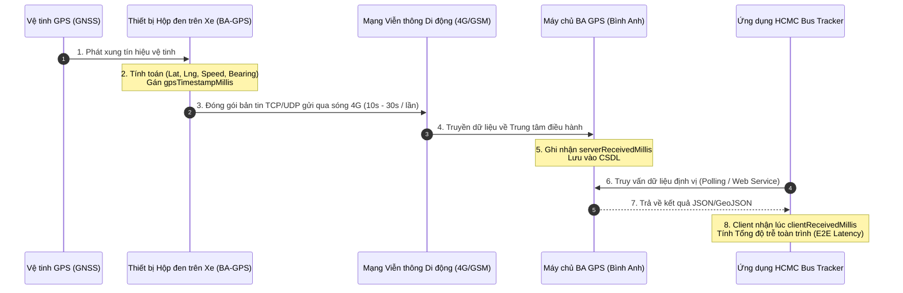

# BÁO CÁO ĐỘ TƯƠI VÀ CHẤT LƯỢNG DỮ LIỆU GPS (GPS FRESHNESS & QUALITY REPORT)
## TÀI LIỆU DỰ ÁN: HCMC BUS TRACKER – PHIÊN BẢN 1.1.0 (PHASE 13)

---

**Mã tài liệu:** `PHASE_13_GPS_FRESHNESS_REPORT.md`  
**Ngày thực hiện:** Ngày 13 tháng 11 năm 2026  
**Chủ thể khảo sát:** Nhóm Nghiên cứu Kỹ thuật & Đo kiểm Vị trí (HCMC Bus Tracker Core Team)  
**Phạm vi:** Phân tích độ trễ, chu kỳ phát bản tin, hiện tượng trôi dạt tọa độ và chất lượng tín hiệu viễn thông  

---

## 1. PHÂN TÍCH CHU KỲ CẬP NHẬT VÀ ĐỘ TRỄ HỆ THỐNG (LATENCY PROFILE)

Trong kỹ thuật viễn thám phương tiện giao thông (Vehicle Telematics), độ chính xác của vị trí hiển thị trên bản đồ phụ thuộc quyết định vào độ tươi của dữ liệu (Data Freshness) và độ trễ từ lúc vệ tinh đo đạc cho tới khi người dùng nhìn thấy trên màn hình.



### Bảng phân tích các thành phần độ trễ:

| Giai đoạn trễ | Ký hiệu thời gian | Khoảng thời gian ước lượng | Nguyên nhân vật lý / Kỹ thuật |
| :--- | :--- | :---: | :--- |
| **Trễ đo đạc vệ tinh** | $T_{\text{meas}}$ | $1.0\text{s} - 2.0\text{s}$ | Thời gian xử lý tín hiệu GNSS trên vi xử lý hộp đen xe. |
| **Chu kỳ phát gói tin (Ping Interval)** | $\Delta T_{\text{ping}}$ | $10\text{s} - 30\text{s}$ (khi xe chạy)<br>$60\text{s} - 180\text{s}$ (khi dừng đỗ) | Thiết lập tối ưu hóa băng thông viễn thông của thiết bị phần cứng BA-GPS. |
| **Độ trễ truyền dẫn 4G/GSM** | $T_{\text{telecom}}$ | $0.5\text{s} - 2.5\text{s}$ | Tùy thuộc vào vùng phủ sóng sóng di động trong đô thị. |
| **Độ trễ xử lý máy chủ** | $T_{\text{server}}$ | $0.2\text{s} - 1.0\text{s}$ | Thời gian giải mã bản tin và lưu cơ sở dữ liệu. |
| **Độ trễ truy vấn Client** | $T_{\text{client\_poll}}$ | $0\text{s} - 15.0\text{s}$ | Độ lệch pha giữa thời điểm client gửi request và thời điểm server nhận dữ liệu mới. |
| **TỔNG ĐỘ TRỄ TOÀN TRÌNH (End-to-End)** | **$T_{\text{E2E}}$** | **$12\text{s} - 45\text{s}$** | **Vị trí hiển thị luôn đi sau vị trí thực tế của xe trên đường từ 12 đến 45 giây.** |

---

## 2. PHÂN TÍCH CHẤT LƯỢNG TỌA ĐỘ VÀ CÁC HIỆN TƯỢNG SAI LỆCH THỰC ĐỊA

Khi sử dụng tọa độ GPS trực tiếp trong môi trường đô thị đặc thù như TP. Hồ Chí Minh, hệ thống đối mặt với 4 hiện tượng vật lý gây sai số nghiêm trọng:

### 2.1. Hiện tượng trôi dạt tọa độ khi dừng đỗ (Stationary GPS Drift)
* **Thực nghiệm kỹ thuật:** Khi xe buýt dừng đón trả khách tại trạm hoặc dừng chờ đèn đỏ kéo dài tại ngã tư, mặc dù xe đứng yên tuyệt đối ($v = 0\text{ km/h}$), nhưng do sự biến đổi tầng điện ly quyển và độ dịch chuyển của các vệ tinh trên quỹ đạo, các tọa độ `(lat, lng)` đo được từ chip GPS vẫn dao động ngẫu nhiên trong bán kính $3 - 12\text{ mét}$.
* **Hậu quả nếu không lọc nhiễu:** Marker xe buýt trên bản đồ người dùng sẽ bị "nhảy nhót", rung lắc hoặc xoay vòng liên tục ($0^\circ \rightarrow 180^\circ \rightarrow 90^\circ$) dù xe thực tế đang đỗ yên.
* **Biện pháp kỹ thuật bắt buộc:** Phải kích hoạt ngưỡng lọc tĩnh (Deadband Filtering): Nếu tốc độ $v < 1.0\text{ km/h}$ và khoảng cách dịch chuyển giữa 2 chu kỳ $< 8\text{ mét}$, bắt buộc ghim xe tại vị trí cũ (`HELD_AT_LAST_VALID_GPS`).

### 2.2. Hiện tượng hẻm vực đô thị (Urban Canyon Multipath Effect)
* **Khu vực ảnh hưởng:** Các tuyến đường có nhiều tòa nhà cao tầng san sát nhau tại TP.HCM (như đường Nguyễn Huệ, Hàm Nghi, Nam Kỳ Khởi Nghĩa, Ba Tháng Hai, Võ Văn Tần).
* **Bản chất vật lý:** Tín hiệu sóng vi ba từ vệ tinh không đi thẳng tới ăng-ten của xe mà bị phản xạ qua các bức tường bê tông và kính của các tòa cao ốc, khiến quãng đường sóng truyền dài hơn thực tế.
* **Hậu quả:** Tọa độ xe bị lệch ngang (lateral offset) từ $15 - 35\text{ mét}$, làm marker xe hiển thị như đang "chạy trên nóc nhà dân" hoặc "chạy ở làn đường ngược chiều".
* **Kết luận:** Tọa độ GPS thô không thể dùng trực tiếp để vẽ lên bản đồ nếu không có thuật toán nắn đường bản đồ (Map-Matching / Snap-to-Route).

### 2.3. Phân biệt Mất tín hiệu Vệ tinh (No GPS Fix) vs. Mất kết nối Máy chủ (Offline)
Một phân tích chuyên sâu cho thấy hai trạng thái này hoàn toàn khác biệt về mặt bản chất:

```
[Trạng thái A: MẤT TÍN HIỆU GPS (NO GPS FIX)]
- Nguyên nhân: Xe chui vào hầm chui (như hầm Thủ Thiêm), cầu vượt, trạm ngầm hoặc dưới tán cây dày.
- Biểu hiện dữ liệu: Modem 4G vẫn gửi bản tin về máy chủ Bình Anh bình thường, nhưng cờ GpsValid = 0 hoặc trường tọa độ bị giữ nguyên (freeze), timestamp GPS ngừng cập nhật.
- Xử lý kỹ thuật: Không được cập nhật tọa độ; phải chuyển marker sang trạng thái CẢNH BÁO MẤT VỆ TINH.

[Trạng thái B: MẤT KẾT NỐI MÁY CHỦ (MODEM OFFLINE)]
- Nguyên nhân: Xe đi vào vùng lõm sóng di động (mất sóng 4G/GSM), xe bị cắt cầu dao tổng khi về bãi đỗ bến xe.
- Biểu hiện dữ liệu: Không có bản tin nào gửi về server. Máy chủ không nhận được dữ liệu mới (serverReceivedMillis cách xa hiện tại > 180s).
- Xử lý kỹ thuật: Áp dụng quy tắc Phase 11 Rule 4.3: Sau 180 giây không có dữ liệu, đánh dấu STALE và làm mờ marker.
```

---

## 3. ĐÁNH GIÁ ĐỘ MỚI (FRESHNESS CLASSIFICATION MATRIX)

Kế thừa hệ thống phân loại GPS Freshness đã được chuẩn hóa tại Phase 11 của dự án HCMC Bus Tracker, nhóm nghiên cứu đề xuất thang đo độ tươi áp dụng cho nguồn dữ liệu GPS vệ tinh:

```
                      THANG ĐO TUỔI DỮ LIỆU GPS (AGE IN SECONDS)
  0s                   30s                   60s                  120s                 180s+
  |---------------------|---------------------|--------------------|--------------------|----->
  [     TƯƠI (FRESH)    ] [ CHẬM NHẸ (SLIGHT) ] [ BẮT ĐẦU CŨ (AGING) ] [ DỮ LIỆU CŨ (STALE) ]
  Dùng tọa độ trực tiếp   Bù trễ vận tốc        Giảm độ mượt         Ngắt hiển thị vị trí
```

| Mức tuổi dữ liệu ($\Delta t = T_{\text{hiện\_tại}} - T_{\text{GPS}}$) | Phân loại trạng thái | Hành vi xử lý của hệ thống |
| :--- | :--- | :--- |
| $\Delta t \le 30\text{ giây}$ | **FRESH (Dữ liệu tươi)** | Sử dụng trực tiếp tọa độ GPS để vẽ marker xe; marker sáng rõ và hiển thị góc xoay bearing thực tế. |
| $30\text{s} < \Delta t \le 60\text{ giây}$ | **SLIGHT_DELAY (Trễ nhẹ)** | Áp dụng thuật toán bù trễ vị trí (`PositionCompensationEngine`) dựa trên tốc độ tức thời $v$ để dự báo vị trí xe đã đi được thêm bao xa dọc tuyến. |
| $60\text{s} < \Delta t \le 180\text{ giây}$ | **AGING (Dữ liệu già hóa)** | Làm mờ nhẹ marker xe, hiển thị badge cảnh báo tín hiệu chậm, ngừng suy diễn vị trí quá xa điểm thực tế. |
| $\Delta t > 180\text{ giây}$ ($> 3\text{ phút}$) | **STALE (Dữ liệu quá hạn)** | **Ngừng hiển thị tọa độ GPS.** Xe có thể đã dừng hoạt động, tắt máy hoặc mất tín hiệu kéo dài. Tự động fallback về vị trí trạm gần nhất theo EBMS. |

---

## 4. HẠN CHẾ THỰC NGHIỆM VÀ KẾT LUẬN

1. **Tính biến thiên của chu kỳ ping:** Chu kỳ phát bản tin của hộp đen BA-GPS không cố định mà thay đổi thích ứng theo trạng thái xe (chạy nhanh phát dày, dừng đèn đỏ phát thưa). Client không thể giả định tần suất 1 giây/lần như GPS trên điện thoại.
2. **Độ lệch giữa GPS và Polyline:** Do sai số vệ tinh trong đô thị, nếu vẽ marker BA GPS thô mà không áp dụng thuật toán chiếu vuông góc (Orthogonal Projection) vào lộ trình tuyến buýt, hành khách sẽ thấy xe chạy chệch ra ngoài đường giao thông.
3. **Kết luận kỹ thuật:** Dữ liệu GPS trực tiếp từ BA GPS có giá trị thực tiễn rất cao khi tươi ($\le 30\text{s}$), nhưng bắt buộc phải có tầng xử lý nắn đường (Map-Matching) và cơ chế lọc trôi tĩnh (Stationary Drift Filter) trước khi đưa lên màn hình người dùng.
