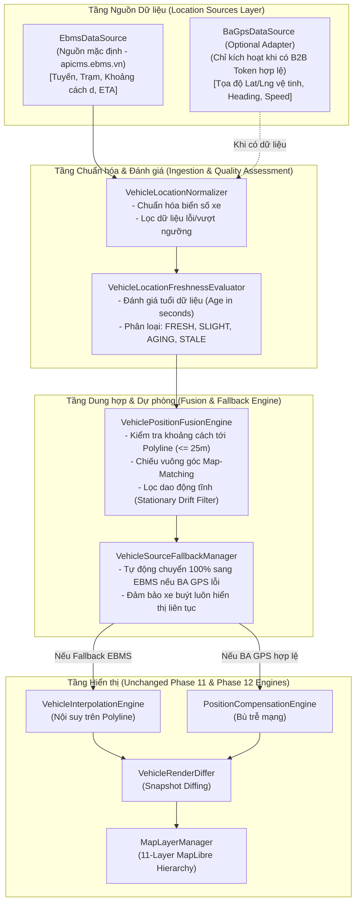

# ĐỀ XUẤT THIẾT KẾ KIẾN TRÚC ĐA NGUỒN PHIÊN BẢN 1.1.0 (V1.1.0 ARCHITECTURE PROPOSAL)
## TÀI LIỆU DỰ ÁN: HCMC BUS TRACKER – PHIÊN BẢN 1.1.0 (PHASE 13)

---

**Mã tài liệu:** `PHASE_13_V1_1_0_ARCHITECTURE_PROPOSAL.md`  
**Ngày thực hiện:** Ngày 13 tháng 11 năm 2026  
**Chủ thể thiết kế:** Nhóm Nghiên cứu Kỹ thuật & Kiến trúc Phần mềm (HCMC Bus Tracker Core Team)  
**Trạng thái thiết kế:** Đề xuất kỹ thuật trên tài liệu – **CHƯA TRIỂN KHAI CODE VÀO SOURCE CODE DỰ ÁN**  

---

## 1. NGUYÊN TẮC BẢO TOÀN KIẾN TRÚC CỐT LÕI (PROTECTION BOUNDARY)

Bản thiết kế kiến trúc cho Version `1.1.0` được xây dựng dựa trên nguyên tắc **Không xâm lấn (Non-Invasive Architecture)**, bảo vệ toàn vẹn các module và thuật toán cốt lõi đã hoàn thiện và nghiệm thu ở Phase 11 và Phase 12:

```
╔═══════════════════════════════════════════════════════════════════════════════════════════╗
║                      DANH MỤC CÁC THÀNH PHẦN BẢO VỆ TUYỆT ĐỐI                             ║
╠═══════════════════════════════════════════════════════════════════════════════════════════╣
║ 1. VehicleInterpolationEngine    : Giữ nguyên thuật toán nội suy polyline theo khoảng cách.║
║ 2. PositionCompensationEngine   : Giữ nguyên thuật toán bù trễ mạng và dự báo vị trí xe.  ║
║ 3. VehicleRenderDiffer           : Giữ nguyên cơ chế so sánh snapshot phân biệt render.    ║
║ 4. VehicleMarkerBitmapFactory    : Giữ nguyên hình học Top-Down Coach chuẩn 44dp.          ║
║ 5. MapLayerManager               : Giữ nguyên cây 11 lớp Z-order hiển thị MapLibre.        ║
║ 6. GlobalPollingCoordinator      : Giữ nguyên chu kỳ polling thích ứng EBMS.               ║
║ 7. Database & Room Schema        : Giữ nguyên sơ đồ cơ sở dữ liệu v3 hiện hữu.             ║
╚═══════════════════════════════════════════════════════════════════════════════════════════╝
```

---

## 2. SƠ ĐỒ KIẾN TRÚC HỆ THỐNG V1.1.0 (ARCHITECTURE DIAGRAM)



---

## 3. ĐẶC TẢ GIAO DIỆN PHẦN MỀM (KOTLIN INTERFACE SPECIFICATIONS)

Các giao diện lập trình sau đây được thiết kế độc lập, đóng vai trò là hợp đồng giao tiếp (Contracts) chuẩn bị cho việc triển khai trong các phase tiếp theo:

### 3.1. Giao diện Nguồn Vị trí Tổng quát (`VehicleLocationSource`)
```kotlin
package com.hcmcbustracker.core.model.source

import kotlinx.coroutines.flow.Flow

/**
 * Giao diện trừu tượng hóa mọi nguồn dữ liệu vị trí phương tiện.
 */
interface VehicleLocationSource {
    val sourceId: String
    val isAvailable: Boolean
    
    /**
     * Lắng nghe dòng dữ liệu định vị theo thời gian thực của danh sách xe.
     */
    fun observeVehiclePositions(routeId: Int, varId: Int): Flow<List<RawVehiclePositionSnapshot>>
}

data class RawVehiclePositionSnapshot(
    val sourceId: String,
    val normalizedPlate: String,
    val latitude: Double?,
    val longitude: Double?,
    val speedKmH: Double?,
    val bearingDegrees: Float?,
    val distanceAlongRouteMeters: Double?,
    val timestampMillis: Long,
    val isSignalValid: Boolean
)
```

### 3.2. Nguồn dữ liệu EBMS (`EbmsDataSource`)
```kotlin
package com.hcmcbustracker.core.network.source

import com.hcmcbustracker.core.model.source.RawVehiclePositionSnapshot
import com.hcmcbustracker.core.model.source.VehicleLocationSource
import kotlinx.coroutines.flow.Flow

/**
 * Adapter triển khai nguồn EBMS hiện tại.
 * Luôn sẵn sàng và là nguồn tin cậy tối cao về lộ trình xe buýt.
 */
class EbmsDataSource(
    private val globalPollingCoordinator: Any // Tham chiếu coordinator Phase 11
) : VehicleLocationSource {
    override val sourceId: String = "EBMS_OFFICIAL"
    override val isAvailable: Boolean = true

    override fun observeVehiclePositions(routeId: Int, varId: Int): Flow<List<RawVehiclePositionSnapshot>> {
        // Ánh xạ dữ liệu từ GlobalPollingCoordinator hiện tại
        TODO("Sẽ triển khai trong Phase tích hợp")
    }
}
```

### 3.3. Nguồn dữ liệu BA GPS (`BaGpsDataSource`)
```kotlin
package com.hcmcbustracker.core.network.source

import com.hcmcbustracker.core.model.source.RawVehiclePositionSnapshot
import com.hcmcbustracker.core.model.source.VehicleLocationSource
import kotlinx.coroutines.flow.Flow

/**
 * Adapter kết nối với nguồn BA GPS.
 * Chỉ hoạt động khi có Enterprise B2B Token hợp lệ; nếu không, isAvailable = false.
 */
class BaGpsDataSource(
    private val authTokenProvider: Any?
) : VehicleLocationSource {
    override val sourceId: String = "BA_GPS_ENTERPRISE"
    override val isAvailable: Boolean
        get() = authTokenProvider != null // Chỉ kích hoạt khi có hợp đồng ủy quyền

    override fun observeVehiclePositions(routeId: Int, varId: Int): Flow<List<RawVehiclePositionSnapshot>> {
        // Kết nối API B2B chính thức của Bình Anh (REST/WebSocket)
        TODO("Chỉ triển khai khi có văn bản ủy quyền chính thức từ FUTA & Bình Anh")
    }
}
```

### 3.4. Bộ chuẩn hóa dữ liệu (`VehicleLocationNormalizer`)
```kotlin
package com.hcmcbustracker.core.model.normalizer

object VehicleLocationNormalizer {
    /**
     * Chuẩn hóa biển số xe để so sánh đồng nhất giữa hai hệ thống.
     * Ví dụ: "51B-123.45" -> "51B12345"
     */
    fun normalizePlate(raw: String): String {
        return raw.uppercase().replace(Regex("[^A-Z0-9]"), "")
    }

    /**
     * Kiểm tra tính hợp lệ của tọa độ GPS theo chuẩn WGS-84 trên lãnh thổ Việt Nam.
     */
    fun isValidVietnamGps(lat: Double, lng: Double): Boolean {
        return lat in 8.0..24.0 && lng in 102.0..110.0
    }
}
```

### 3.5. Bộ đánh giá độ tươi dữ liệu (`VehicleLocationFreshnessEvaluator`)
```kotlin
package com.hcmcbustracker.core.model.evaluator

import com.hcmcbustracker.core.model.GpsFreshnessState

class VehicleLocationFreshnessEvaluator {
    fun evaluateFreshness(
        gpsTimestampMillis: Long,
        currentTimeMillis: Long = System.currentTimeMillis()
    ): GpsFreshnessState {
        val ageSeconds = (currentTimeMillis - gpsTimestampMillis) / 1000L
        return when {
            ageSeconds <= 30 -> GpsFreshnessState.FRESH
            ageSeconds in 31..60 -> GpsFreshnessState.FRESH // Cho phép bù trễ
            ageSeconds in 61..180 -> GpsFreshnessState.AGING
            else -> GpsFreshnessState.STALE
        }
    }
}
```

### 3.6. Động cơ dung hợp dữ liệu (`VehiclePositionFusionEngine`)
```kotlin
package com.hcmcbustracker.core.model.fusion

import com.hcmcbustracker.core.model.RoutePath
import com.hcmcbustracker.core.model.source.RawVehiclePositionSnapshot

sealed class FusedPositionResult {
    data class GpsDirect(val lat: Double, val lng: Double, val bearing: Float) : FusedPositionResult()
    data class FallbackInterpolated(val distanceAlongRouteMeters: Double) : FusedPositionResult()
}

class VehiclePositionFusionEngine {
    companion object {
        const val MAX_ROUTE_DEVIATION_METERS = 25.0 // Ngưỡng lệch tuyến tối đa
    }

    /**
     * Quyết định sử dụng tọa độ GPS trực tiếp hay quay về nội suy tuyến.
     */
    fun fuse(
        gpsSnapshot: RawVehiclePositionSnapshot?,
        ebmsDistanceMeters: Double?,
        routePolyline: RoutePath
    ): FusedPositionResult {
        if (gpsSnapshot?.latitude != null && gpsSnapshot.longitude != null && gpsSnapshot.isSignalValid) {
            val distToPolyline = computeShortestDistanceToPolyline(
                gpsSnapshot.latitude,
                gpsSnapshot.longitude,
                routePolyline
            )
            // Nếu xe bám sát lộ trình trong phạm vi cho phép
            if (distToPolyline <= MAX_ROUTE_DEVIATION_METERS) {
                val snappedCoord = snapToPolyline(gpsSnapshot.latitude, gpsSnapshot.longitude, routePolyline)
                val bearing = gpsSnapshot.bearingDegrees ?: computePolylineBearing(snappedCoord, routePolyline)
                return FusedPositionResult.GpsDirect(snappedCoord.first, snappedCoord.second, bearing)
            }
        }
        // Fallback an toàn về nội suy EBMS
        return FusedPositionResult.FallbackInterpolated(ebmsDistanceMeters ?: 0.0)
    }

    private fun computeShortestDistanceToPolyline(lat: Double, lng: Double, polyline: RoutePath): Double = 0.0
    private fun snapToPolyline(lat: Double, lng: Double, polyline: RoutePath): Pair<Double, Double> = Pair(lat, lng)
    private fun computePolylineBearing(coord: Pair<Double, Double>, polyline: RoutePath): Float = 0f
}
```

### 3.7. Bộ quản lý chuyển đổi dự phòng (`VehicleSourceFallbackManager`)
```kotlin
package com.hcmcbustracker.core.model.fallback

class VehicleSourceFallbackManager {
    /**
     * Đảm bảo tính liên tục của trải nghiệm người dùng:
     * Tự động vô hiệu hóa adapter BA GPS và quay về nguồn EBMS thuần túy
     * khi phát hiện bất kỳ lỗi kết nối, lỗi xác thực hoặc tín hiệu trễ quá hạn.
     */
    fun shouldFallbackToEbms(
        isBaGpsAvailable: Boolean,
        isGpsStale: Boolean,
        hasNetworkError: Boolean
    ): Boolean {
        return !isBaGpsAvailable || isGpsStale || hasNetworkError
    }
}
```

---

## 4. QUY ĐỊNH BẢO MẬT & BẢO VỆ MÃ NGUỒN TRONG TƯƠNG LAI

Nhằm ngăn ngừa triệt để các hành vi vi phạm an toàn thông tin khi chuyển sang giai đoạn phát triển tiếp theo, dự án đặt ra **5 điều cấm tuyệt đối**:

1. **CẤM NHÚNG TÀI KHOẢN VÀO MÃ NGUỒN:** Tuyệt đối không hard-code tên đăng nhập, mật khẩu tài khoản BA GPS vào tệp `.kt`, `.xml`, `gradle.properties` hoặc git repository.
2. **CẤM LƯU TRỮ SESSION TOKEN:** Không lưu cookie trình duyệt hoặc token phiên làm việc vào tệp cấu hình đóng gói trong APK phát hành.
3. **CẤM DỰNG PROXY TRÁI PHÉP:** Không tự ý dựng server proxy trung gian để cào màn hình (scrape) từ `futagps.binhanh.vn` rồi phân phối lại dữ liệu mà không có thỏa thuận bản quyền bằng văn bản.
4. **CẤM THU THẬP THÔNG TIN TÀI XẾ:** Bộ chuẩn hóa `VehicleLocationNormalizer` phải có bộ lọc chủ động loại bỏ trường định danh tài xế trước khi đưa vào luồng dữ liệu của app.
5. **CẤM LÀM GIÁN ĐOẠN XE KHÔNG PHẢI FUTA:** Mọi tuyến xe buýt công cộng không thuộc FUTA phải luôn được xử lý trơn tru qua EBMS mà không bị ảnh hưởng bởi trạng thái của module BA GPS.
