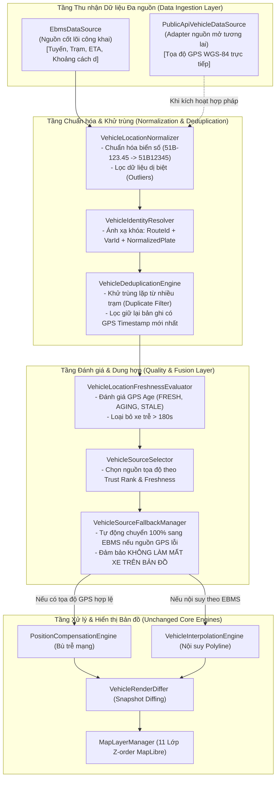

# ĐỀ XUẤT THIẾT KẾ KIẾN TRÚC ĐA NGUỒN PHIÊN BẢN 1.1.0 (MULTI-SOURCE DATA ARCHITECTURE)
## (PHASE 15 – V1.1.0 ARCHITECTURE SPECIFICATION)

---

**Dự án:** HCMC Bus Tracker  
**Phiên bản mục tiêu:** `1.1.0`  
**Giai đoạn:** Thiết kế kiến trúc trừu tượng (Document-only Architecture Proposal)  
**Trạng thái triển khai:** **CHƯA TRIỂN KHAI CODE VÀO SẢN PHẨM (DO NOT IMPLEMENT YET)**  
**Ngày thực hiện:** Ngày 13 tháng 11 năm 2026  

---

## 1. NGUYÊN TẮC THIẾT KẾ HỆ THỐNG ĐA NGUỒN

Kiến trúc phiên bản `1.1.0` được thiết kế nhằm mục tiêu:
1. **Dung hợp đa nguồn linh hoạt (Pluggable Multi-Source):** Cho phép gắn thêm bất kỳ nguồn dữ liệu công khai hoặc đối tác chính thức nào trong tương lai mà không làm thay đổi các tầng nghiệp vụ bên dưới.
2. **Khử trùng lặp chuẩn xác (Deterministic Deduplication):** Ghép nối phương tiện thông qua khóa định danh biển số chuẩn hóa (`Normalized Plate Identifier`), tuyệt đối không gộp các bản ghi chỉ vì vị trí gần nhau.
3. **Cơ chế Dự phòng Bền vững (Fail-Safe Fallback):** Nguồn cốt lõi EBMS luôn duy trì $100\%$ làm nguồn bảo vệ; nếu nguồn vệ tinh mới bị gián đoạn, xe buýt vẫn hiển thị mượt mà trên bản đồ.

---

## 2. SƠ ĐỒ DÒNG DỮ LIỆU ĐA NGUỒN (MULTI-SOURCE DATA FLOW)



---

## 3. CẤU TRÚC SIÊU DỮ LIỆU PHƯƠNG TIỆN (VEHICLE METADATA SCHEMA)

Mọi bản ghi phương tiện khi đi qua hệ thống dung hợp sẽ được gắn kèm bộ siêu dữ liệu xuất xứ (Provenance Metadata):

```kotlin
/**
 * Mô hình dữ liệu phương tiện dung hợp đa nguồn chuẩn bị cho Version 1.1.0.
 */
data class UnifiedVehicleRecord(
    // 1. Định danh phương tiện
    val sourceId: String,                    // Ví dụ: "EBMS_OFFICIAL", "PARTNER_PUBLIC_API"
    val originalVehicleId: String,          // Mã gốc từ payload nhà cung cấp
    val normalizedVehicleIdentity: String,   // Biển số chuẩn hóa: "51B12345"
    
    // 2. Định danh tuyến vận hành
    val routeId: Int,
    val varId: Int,
    val routeNo: String,
    
    // 3. Tọa độ và động học
    val latitude: Double?,                   // Tọa độ WGS-84 (nếu có nguồn trực tiếp)
    val longitude: Double?,
    val speedKmH: Double,
    val bearingDegrees: Float?,              // Góc hướng di chuyển (0..360)
    val distanceAlongRouteMeters: Double,    // Khoảng cách d từ EBMS
    
    // 4. Siêu dữ liệu thời gian & nguồn gốc
    val gpsTimestampMillis: Long?,           // Mốc thời gian thiết bị ghi nhận
    val receivedTimestampMillis: Long,       // Mốc thời gian client tiếp nhận
    val sourcePriority: Int,                 // Điểm ưu tiên tin cậy (Trust Rank)
    val freshnessState: GpsFreshnessState,   // FRESH, AGING, STALE, UNCHANGED
    val confidenceLevel: Float               // Mức độ tin cậy dữ liệu (0.0 .. 1.0)
)
```

---

## 4. QUY TẮC GHÉP NỐI VÀ KHỬ TRÙNG LẶP (DEDUPLICATION RULES)

1. **Khóa định danh duy nhất:**
   `VehicleObservationKey(routeId = routeId, varId = varId, normalizedPlate = normalizedPlate)`
2. **Quy tắc giải quyết xung đột bản ghi (Conflict Resolution):**
   - Nếu nhận được hai bản ghi cho cùng một phương tiện trong cùng một chu kỳ polling:
     - Ưu tiên bản ghi có `gpsTimestampMillis` lớn hơn (mới hơn).
     - Nếu timestamp bằng nhau: Ưu tiên nguồn có điểm tin cậy `sourcePriority` cao hơn (nguồn có GPS trực tiếp được ưu tiên hơn nguồn nội suy khoảng cách).
3. **Quy tắc chống xóa oan phương tiện (Anti-Starvation):**
   - Nếu nguồn bổ sung tạm thời trả về danh sách rỗng hoặc lỗi mạng, hệ thống **tuyệt đối không xóa phương tiện khỏi bản đồ**, mà ngay lập tức chuyển trạng thái sang nội suy theo dữ liệu EBMS hiện có.

---

## 5. QUY TẮC CHUYỂN ĐỔI DỰ PHÒNG (FALLBACK ENGINE SPECIFICATION)

```
┌────────────────────────────────────────────────────────────────────────────────────────┐
│                        MA TRẬN QUYẾT ĐỊNH DỰ PHÒNG (FALLBACK MATRIX)                    │
├───────────────────────────────────┬────────────────────────────────┬───────────────────┤
│ Điều kiện dữ liệu đầu vào         │ Hành vi của SourceSelector     │ Tầng xử lý vị trí │
├───────────────────────────────────┼────────────────────────────────┼───────────────────┤
│ Có GPS trực tiếp VÀ Age <= 30s    │ Kích hoạt GPS Trực tiếp        │ PositionCompEngine│
│ Có GPS trực tiếp VÀ 30s < Age <=60s│ Bù trễ vận tốc (Compensation)  │ PositionCompEngine│
│ Có GPS trực tiếp VÀ Age > 120s    │ HỦY BỎ GPS TRỰC TIẾP (STALE)   │ Fallback EBMS     │
│ Nguồn phụ lỗi mạng / Timeout      │ TỰ ĐỘNG CHUYỂN SANG EBMS       │ InterpEngine      │
│ Xe không thuộc nguồn bổ sung      │ SỬ DỤNG 100% NGUỒN EBMS MẶC ĐỊNH│ InterpEngine      │
└───────────────────────────────────┴────────────────────────────────┴───────────────────┘
```

**Kết luận kiến trúc:**  
Mô hình kiến trúc đa nguồn này mang tính độc lập hoàn toàn, không xâm lấn vào mã nguồn sản phẩm Phase 11 & 12, đảm bảo hệ thống luôn vững chắc và sẵn sàng nâng cấp bất cứ khi nào có thêm nguồn dữ liệu công khai mới.
